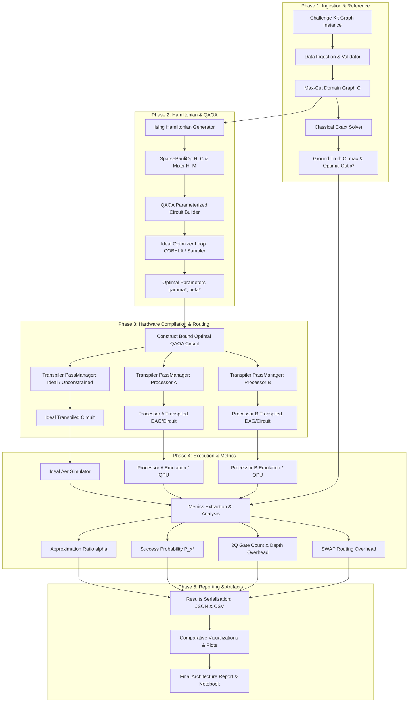

# Qiskit Fall Fest 2026 — Quantum Optimization — O1 Max-Cut
## Architectural & Engineering Specification (PROJECT_SPEC.md)

**Document Version:** 1.0.0  
**Project Track:** Quantum Optimization — O1 Max-Cut  
**Status:** Frozen Specification / Phase 0 Architecture  
**Target Platform:** Python 3.10+ / Qiskit 2.x Ecosystem  

---

## 1. Executive Summary & Objective

The objective of this project is to build a robust, reproducible, and mathematically rigorous quantum optimization solution for the **O1 Max-Cut** problem using the **Quantum Approximate Optimization Algorithm (QAOA)** under the Qiskit Fall Fest 2026 challenge requirements.

The system will:
1. Parse and validate the organizer-provided graph instance(s) from the official Challenge Kit.
2. Compute an exact/high-fidelity classical reference solution (ground truth optimum $C_{\max}$ and optimal partition).
3. Formulate the Max-Cut problem into an Ising spin Hamiltonian using current Qiskit 2.x operator abstractions (`SparsePauliOp`).
4. Construct and optimize parameterized QAOA ansatzes across varying depths ($p \ge 1$).
5. Execute end-to-end transpilation, routing, and comparative evaluation targeting **Processor A** and **Processor B** using official organizer architectural specifications.
6. Benchmark, quantify, and visualize architectural trade-offs: circuit depth, two-qubit gate overhead, SWAP insertion counts, approximation ratios ($\alpha = \langle C \rangle / C_{\max}$), success probabilities, and runtime efficiency.
7. Deliver a clean, tested, modular repository and an end-to-end executable Jupyter notebook demonstrating full scientific reproducibility.

---

## 2. Frozen Scope & Boundary Conditions

To maintain alignment with competition guidelines and ensure fair, direct comparability with other submissions, the following boundaries are frozen:

### In-Scope
* **Problem Focus:** O1 Max-Cut only.
* **Algorithmic Core:** QAOA (Quantum Approximate Optimization Algorithm) alongside a verified classical reference solver.
* **Hardware Targets:**
  * Local ideal statevector / shot-based simulation via `qiskit-aer`.
  * Noise-modeled / fake backend simulation representing **Processor A** and **Processor B**.
  * IBM Quantum hardware submission via `qiskit-ibm-runtime` (if hardware access credentials are provided and required).
* **Target Comparison:** Exact comparative analysis between **Processor A** and **Processor B** based solely on organizer-provided specifications (topology, basis gates, error rates, coherence times).
* **Deliverables:** Modular Python package (`src/`), unit & integration test suite (`tests/`), end-to-end experiment notebook (`notebooks/`), benchmark result artifacts (`results/`), and architectural summary report (`docs/`).

### Strict Non-Goals (Out of Scope)
* **No Alternative Tracks:** Do not implement O2 (e.g., TSP, Knapsack), O3, or Open Innovation tracks.
* **No Unrelated Software Artifacts:** Absolutely no web apps, REST APIs, microservices, databases, mobile apps, or UI dashboards.
* **No Unauthorized Processors:** Phase 1 evaluation terminates strictly at Processor A and Processor B. Do not invent Processor C, custom Processor D, or hypothetical architectures.
* **No Fabricated Data:** Do not invent problem graphs, coupling maps, calibration profiles, or expected benchmark metrics. The official Challenge Kit is the single source of truth.
* **No Deprecated Code:** Do not use obsolete Qiskit 0.x/1.x paradigms (e.g., `qiskit.opflow`, `qiskit.algorithms.QAOA`, legacy `BackendV1`, legacy `execute` calls). Only modern Qiskit 2.x primitives and transpiler service workflows are permitted.

---

## 3. Layered Architectural Model

The project is structured into 10 decoupled, testable architectural layers:

```
+-----------------------------------------------------------------------+
| Layer 10: Documentation & Reproducibility                             |
| (Jupyter Notebook, Hardware Comparison Report, Experiment Metadata)   |
+-----------------------------------------------------------------------+
                                   |
+-----------------------------------------------------------------------+
| Layer 9: Visualization & Analysis                                      |
| (Graph Partition Cuts, Energy Landscapes, Radar/Bar Resource Charts)  |
+-----------------------------------------------------------------------+
                                   |
+-----------------------------------------------------------------------+
| Layer 8: Metrics & Result Storage                                     |
| (Approximation Ratio, Success Prob, Depth, 2Q Gate Count, JSON/CSV)   |
+-----------------------------------------------------------------------+
                                   |
+-----------------------------------------------------------------------+
| Layer 7: Experiment Execution Engine                                  |
| (Sweep Over p, Transpiler Levels 1-3, Multi-Backend Execution Matrix) |
+-----------------------------------------------------------------------+
                                   |
+-----------------------------------------------------------------------+
| Layer 6: Backend & Transpiler Abstraction                              |
| (Local Aer, Noisy Emulation, Processor A Model, Processor B Model)    |
+-----------------------------------------------------------------------+
                                   |
+-----------------------------------------------------------------------+
| Layer 5: QAOA Circuit & Parameter Optimization                        |
| (Cost/Mixer Layers, Parameterized Circuits, COBYLA/SLSQP, Primitives) |
+-----------------------------------------------------------------------+
                                   |
+-----------------------------------------------------------------------+
| Layer 4: QUBO & Ising Hamiltonian Formulation                          |
| (Graph-to-Spin Transformation, SparsePauliOp Construction)            |
+-----------------------------------------------------------------------+
                                   |
+-----------------------------------------------------------------------+
| Layer 3: Classical Reference Solver                                   |
| (Exact Brute-Force / Integer Solver Ground Truth C_max & Cut State)   |
+-----------------------------------------------------------------------+
                                   |
+-----------------------------------------------------------------------+
| Layer 2: Max-Cut Domain Model                                         |
| (NetworkX Graph Validation, Node/Edge Weight Processing, Cut Evaluator)|
+-----------------------------------------------------------------------+
                                   |
+-----------------------------------------------------------------------+
| Layer 1: Challenge & Data Ingestion                                   |
| (Challenge Kit File Parsers, JSON/Adjacency Matrix Loaders, Schema)   |
+-----------------------------------------------------------------------+
```

### Layer Details

1. **Layer 1: Challenge & Data Input (`src/io/`)**
   * Responsible for ingesting instance definitions from the official Challenge Kit (adjacency matrices, edge lists, or JSON specs).
   * Schema validation and sanitization of graph topology and weights.

2. **Layer 2: Max-Cut Domain Model (`src/domain/`)**
   * Encapsulates the mathematical graph using `networkx.Graph`.
   * Evaluates classical cut values: for cut partition $x \in \{0, 1\}^n$,
     $$C(x) = \sum_{(u, v) \in E} w_{uv} \, (x_u \oplus x_v)$$
   * Checks connectivity, degree distribution, and problem scale ($|V|, |E|$).

3. **Layer 3: Classical Reference Solver (`src/classical/`)**
   * Computes the certified ground truth optimum $C_{\max} = \max_{x} C(x)$.
   * Exact enumeration / branch-and-bound for instances within competition scale ($N \le 20$).
   * Optional heuristic baseline (Goemans-Williamson SDP relaxation or greedy cut) for verification and sanity checking.

4. **Layer 4: QUBO/Ising Formulation (`src/formulation/`)**
   * Maps binary variables $x_i \in \{0, 1\}$ to Pauli-Z spin operators $s_i = 1 - 2x_i \in \{+1, -1\}$:
     $$x_u \oplus x_v = \frac{1 - s_u s_v}{2} = \frac{I - Z_u Z_v}{2}$$
   * Constructs the Cost Hamiltonian as a Qiskit 2.x `SparsePauliOp`:
     $$H_C = \sum_{(u, v) \in E} \frac{w_{uv}}{2} (I - Z_u Z_v)$$
   * Constructs standard transverse-field mixer Hamiltonian:
     $$H_M = \sum_{u \in V} X_u$$

5. **Layer 5: QAOA Circuit & Parameter Optimization (`src/qaoa/`)**
   * Assembles the $p$-layer QAOA circuit:
     $$|\psi(\boldsymbol{\gamma}, \boldsymbol{\beta})\rangle = \prod_{l=1}^p \left( e^{-i \beta_l H_M} e^{-i \gamma_l H_C} \right) |+\rangle^{\otimes n}$$
   * Implements objective evaluation using modern Qiskit Primitives (`SamplerV2` / `EstimatorV2`).
   * Classical optimization loop using bounded COBYLA, SLSQP, or parameter grid search to find optimal $(\boldsymbol{\gamma}^*, \boldsymbol{\beta}^*)$.

6. **Layer 6: Simulator/Hardware Backend Abstraction (`src/backends/`)**
   * Unified backend adapter interface:
     * `AerSimulator` (ideal statevector and shot-based).
     * `ProcessorABackend` (configured with Processor A's coupling map, basis gates, and error model from Challenge Kit).
     * `ProcessorBBackend` (configured with Processor B's coupling map, basis gates, and error model from Challenge Kit).
     * `QiskitRuntimeService` (for real QPU execution if authorized).
   * Level 1 to Level 3 transpilation passes using `qiskit.transpiler.preset_passmanagers.generate_preset_pass_manager`.

7. **Layer 7: Experiment Execution Engine (`src/experiments/`)**
   * Structured orchestrator running parameterized experiment sweeps:
     * Depth sweep ($p = 1, 2, \dots, p_{\max}$).
     * Optimization level sweep (Levels 1, 2, 3).
     * Target architecture comparison (Processor A vs Processor B vs Ideal).
   * Deterministic execution seeded via central RNG configuration.

8. **Layer 8: Metrics & Result Storage (`src/metrics/`, `results/`)**
   * Metrics collected per experiment:
     * **Algorithmic:** Approximation Ratio $\alpha = \frac{\langle C \rangle}{C_{\max}}$, Best Sample Cut $C_{\text{best}}$, Optimal Bitstring Success Probability $P(x^*)$.
     * **Architectural / Transpilation:** Post-transpilation depth, 2-qubit gate count (CX/CZ/ECR), total gate count, SWAP gate insertion count, circuit duration / estimated schedule time.
     * **Computational:** Classical optimization iterations, function evaluations, wall-clock transpilation and execution latency.
   * Persistent storage in structured JSON and consolidated tabular CSV format.

9. **Layer 9: Visualization & Analysis (`src/visualization/`)**
   * High-contrast, publication-grade figures (`matplotlib` / `seaborn`):
     * Graph topology and optimal partition visualization.
     * Approximation ratio vs. QAOA depth $p$.
     * Sampling probability distribution highlighting the ground state.
     * Side-by-side Processor A vs. Processor B architectural radar and bar charts (Depth, 2Q Gates, SWAPs, Fidelity).

10. **Layer 10: Documentation & Reproducibility (`notebooks/`, `docs/`)**
    * Self-contained Jupyter notebook (`notebooks/o1_maxcut_qaoa_pipeline.ipynb`) reproducing the full workflow.
    * Architecture comparison report documenting Processor A vs. Processor B trade-offs.
    * Rigorous hardware execution and seed logs.

---

## 4. Repository Structure

```text
AXCUT/
├── .gitignore
├── README.md
├── PROJECT_SPEC.md
├── requirements.txt
├── pyproject.toml
│
├── data/
│   ├── raw/                        # Original Challenge Kit problem files (unaltered)
│   ├── processed/                  # Validated graph instance representations (JSON / adjacency)
│   └── hardware_specs/             # Processor A & Processor B coupling/basis configs from Kit
│
├── src/
│   ├── __init__.py
│   ├── io/                         # Layer 1: Challenge data ingestion & validation
│   │   ├── __init__.py
│   │   ├── parser.py
│   │   └── validator.py
│   ├── domain/                     # Layer 2: Max-Cut graph domain model
│   │   ├── __init__.py
│   │   ├── graph.py
│   │   └── cut_evaluator.py
│   ├── classical/                  # Layer 3: Classical reference solver (ground truth)
│   │   ├── __init__.py
│   │   ├── brute_force.py
│   │   └── reference_solver.py
│   ├── formulation/                # Layer 4: QUBO and Ising Hamiltonian formulation
│   │   ├── __init__.py
│   │   └── ising.py
│   ├── qaoa/                       # Layer 5: QAOA ansatz & parameter optimization
│   │   ├── __init__.py
│   │   ├── ansatz.py
│   │   └── optimizer.py
│   ├── backends/                   # Layer 6: Backend adapters & hardware targets
│   │   ├── __init__.py
│   │   ├── backend_factory.py
│   │   ├── processor_a.py
│   │   └── processor_b.py
│   ├── experiments/                # Layer 7: Experiment orchestration & execution
│   │   ├── __init__.py
│   │   ├── runner.py
│   │   └── config.py
│   ├── metrics/                    # Layer 8: Metrics calculation & persistence
│   │   ├── __init__.py
│   │   ├── collector.py
│   │   └── serializer.py
│   └── visualization/              # Layer 9: Plotting & comparative charts
│       ├── __init__.py
│       ├── plot_graph.py
│       ├── plot_convergence.py
│       └── plot_hardware_comparison.py
│
├── tests/
│   ├── __init__.py
│   ├── test_io.py
│   ├── test_domain.py
│   ├── test_classical.py
│   ├── test_ising.py
│   ├── test_qaoa.py
│   ├── test_transpiler.py
│   └── test_end_to_end.py
│
├── notebooks/
│   └── o1_maxcut_qaoa_pipeline.ipynb  # Layer 10: Complete executable demonstration
│
├── results/
│   ├── data/                       # Output JSON / CSV metrics
│   └── figures/                    # Exported Matplotlib comparison plots (PDF / PNG)
│
└── docs/
    ├── architecture_report.md      # Processor A vs. B comparative findings
    └── challenge_kit_mapping.md    # Mapping of Challenge Kit inputs to repository layers
```

---

## 5. End-to-End Data & Execution Flow



---

## 6. Detailed Technical Specifications & Standards

### 6.1 Qiskit 2.x API Compliance
* **Hamiltonian Representation:** `qiskit.quantum_info.SparsePauliOp` from label-coefficient tuples or Pauli list.
* **Transpilation:** Modern preset pass managers via:
  ```python
  from qiskit.transpiler.preset_passmanagers import generate_preset_pass_manager
  pm = generate_preset_pass_manager(optimization_level=level, target=target_backend.target)
  transpiled_circuit = pm.run(qaoa_circuit)
  ```
* **Primitives:** Modern V2 primitives:
  * `qiskit.primitives.StatevectorSampler` / `qiskit_aer.primitives.SamplerV2` for shot-based probability sampling.
  * `qiskit_ibm_runtime.SamplerV2` for hardware / runtime execution.

### 6.2 Target Processor Architecture Characterization
The evaluation hinges on a direct, evidence-based architectural comparison between **Processor A** and **Processor B**:
* **Topology & Connectivity:** Coupling map degree, qubit diameter, and native graph embedding efficiency.
* **Native Basis Gate Set:** Single-qubit ($RZ, SX, X$) and two-qubit basis gates ($ECR$ vs. $CZ$ vs. $CX$).
* **Routing Overhead:** Number of SWAP operations inserted by Sabre/Stochastic routing to map non-local cost terms onto hardware connectivity graphs.
* **Error Susceptibility:** Two-qubit gate error rates, coherence limits ($T_1, T_2$), and their impact on circuit depth limit for $p \ge 1$.

---

## 7. Testing Strategy

The repository will employ strict automated testing to guarantee mathematical correctness and software resilience:

| Test Module | Target Layer | Scope | Success Criteria |
| :--- | :--- | :--- | :--- |
| `test_io.py` | Layer 1 | Challenge Kit parser & validator | Correctly loads test graphs; rejects malformed inputs. |
| `test_domain.py` | Layer 2 | Max-Cut cut evaluator | Correct cut evaluation for known bitstrings ($C(00\dots0) = 0$). |
| `test_classical.py` | Layer 3 | Brute-force & exact reference solver | Validated against known small graphs (e.g. 5-node ring, complete $K_4$). |
| `test_ising.py` | Layer 4 | Ising Hamiltonian formulation | Eigenvalues of $H_C$ match classical cut values $C(x)$ exactly. |
| `test_qaoa.py` | Layer 5 | QAOA circuit construction & depth | Correct gate count per layer $p$; circuit parameter binding functions without NaN. |
| `test_transpiler.py`| Layer 6 | Processor A & B mapping | Output circuits strictly conform to target basis gates and coupling constraints. |
| `test_end_to_end.py`| Layers 1-8| Pipeline integration test | End-to-end execution on 4-node graph achieves $\alpha \ge 0.70$ at $p=1$. |

---

## 8. Reproducibility & Traceability Strategy

1. **Deterministic Seeding:**
   * Global Python random seed: `SEED = 42`.
   * NumPy random seed: `np.random.seed(SEED)`.
   * Qiskit transpiler seed: `pm.run(circuit, seed_transpiler=SEED)`.
   * Aer simulator seed: `backend.set_options(seed_simulator=SEED)`.
2. **Environment & Dependency Pinning:**
   * Exact pinned `requirements.txt` specifying compatible versions of `qiskit>=2.0`, `qiskit-aer`, `qiskit-ibm-runtime`, `networkx`, `numpy`, `scipy`, `pandas`, `matplotlib`.
3. **Hardware & Calibration Fingerprinting:**
   * Every result artifact exports metadata including: Qiskit version, timestamp, target backend name/version, coupling map hash, basis gates, transpiler optimization level, and optimizer tolerances.
4. **Data Immutability:**
   * Raw Challenge Kit inputs are stored in `data/raw/` as read-only references; all transformed representations are written to `data/processed/` without altering original assets.

---

## 9. Next Phase Readiness & Dependencies

### Unresolved Dependencies on Challenge Kit & Integration Status
The adapter layer in `src/maxcut/io.py` and documentation in `CHALLENGE_KIT.md` are integrated.
To begin execution, the following official assets must be supplied by the organizers:
1. **Official Problem Instance File(s):** Place in `instances/challenge/` (JSON schema or edge list format).
2. **Processor A Definition:** Place in `data/hardware_specs/processor_a.json` (coupling map, basis gates, qubit counts).
3. **Processor B Definition:** Place in `data/hardware_specs/processor_b.json` (coupling map, basis gates, qubit counts).
4. **Official Competition Metric Criteria:** Required submission schema or scoring thresholds.

See `CHALLENGE_KIT.md` for the complete ingestion specification and validation criteria.
Once these files are mounted, run `python scripts/validate_challenge_kit.py` to verify the loaded problem instance.
