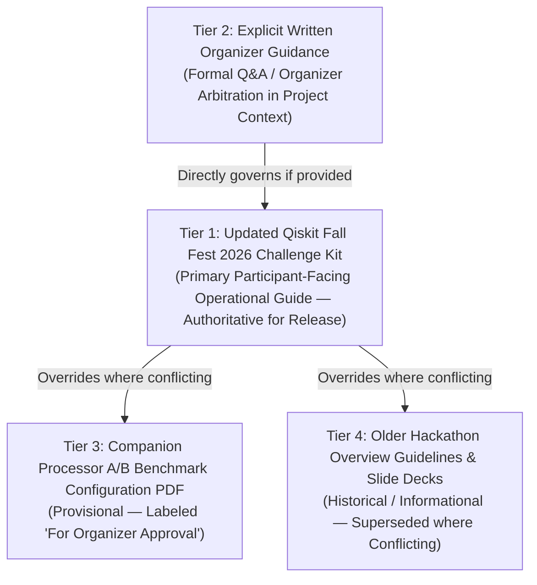
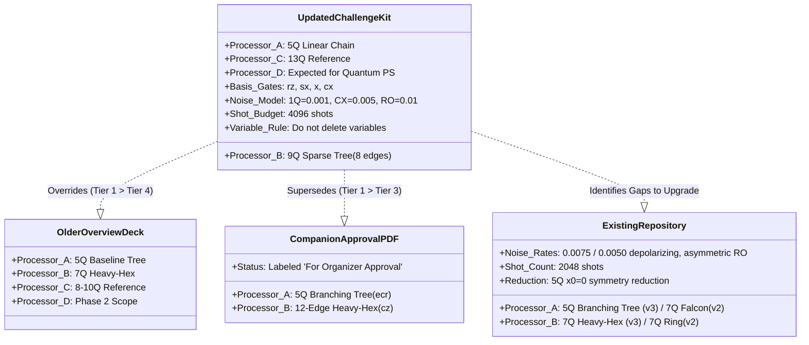

# MAXCUT PHASE 0 — REQUIREMENT FREEZE AND SOURCE CONFLICT RESOLUTION

**Document Identifier:** `docs/audit/PHASE_0_REQUIREMENT_FREEZE.md`  
**Document Version:** 1.0.0  
**Phase:** Phase 0 — Requirement Freeze & Source Conflict Resolution  
**Audit Date:** 2026-10-12  
**Auditor / Engineering Role:** Senior Qiskit Engineer & Hackathon Compliance Auditor  
**Track:** Quantum Optimization — O1 Max-Cut  
**Repository:** [MAXCUT (karthikeyakolli/MAXCUT)](file:///c:/Users/OMEN/.gemini/antigravity-ide/scratch/MAXCUT)  
**Status:** **AUTHORITATIVE REQUIREMENT FREEZE — SOURCE CONFLICTS FORMALLY CATALOGED**

---

## 1. Executive Summary & Audit Mandate

This document establishes the authoritative, binding technical requirements and operational source conflict resolutions governing the **O1 Max-Cut** project for the Qiskit Fall Fest 2026.

### 1.1 Context & Repository Preservation Directive
The repository is an existing, mostly completed QAOA Max-Cut project with a verified mathematical core, 115 passing unit and regression tests, structured results directories (`results/verified_ab_v2/`, `results/verified_ab_v3/`), and established documentation. In strict adherence to hackathon engineering protocol:
- **Do not restart the project.**
- **Do not unnecessarily replace its layered software architecture.**
- **Do not discard, delete, or overwrite prior experiment results.**
- **Do not mutate code, configurations, graph data, or notebooks during Phase 0.**

### 1.2 Audit Outcome & Gate Determination
- **Phase 0 Status:** **COMPLETE & FROZEN**.
- **Operational Source of Truth:** The **Updated Qiskit Fall Fest 2026 Challenge Kit** is established as the primary participant-facing operational guide for this release. Its explicit operational updates supersede older descriptions where conflicts arise.
- **Companion Document Classification:** The companion *Processor A/B Benchmark Configuration PDF* is explicitly labeled *"For Organizer Approval"*. Its divergent topologies and configurations are formally logged in the Conflict Register rather than falsely merged or treated as consensus.
- **Implementation State:** All current-to-target deltas have been identified. Implementation changes remain strictly locked pending progression through scheduled project phases.

---

## 2. Authoritative Source Hierarchy

To resolve discrepancies across distributed hackathon literature without fabricating consensus, the project enforces a strict four-tier precedence hierarchy:

### Hierarchy Rules:
1. **Tier 1 (Operational Standard):** The *Updated Qiskit Fall Fest 2026 Challenge Kit* explicitly defines itself as the operational guide for participants. All default hardware topologies, basis gate sets, synthetic noise rates, and compilation protocols are drawn directly from Tier 1.
2. **Tier 2 (Organizer Overrides):** If explicit, authenticated organizer communications or arbitrations appear within available project materials, that evidence takes precedence over Tier 1. Such evidence must be formally documented with exact citations.
3. **Tier 3 (Provisional Drafts):** Materials explicitly marked *"For Organizer Approval"* represent proposed configurations pending ratification. They provide valuable contextual insight into prospective revisions but cannot silently overwrite Tier 1 operational specifications.
4. **Tier 4 (Historical Decks):** Introductory slide decks (e.g., University of Saskatchewan / quanTA overview slides) represent preliminary or high-level summaries and are formally superseded where they conflict with the updated release kit.
5. **Strict Non-Merge Directive:** Under no circumstances may conflicting hardware specifications (e.g., distinct coupling edge lists or incompatible gate sets) be merged into a synthetic hybrid topology. Each architecture must be evaluated strictly against its defined configuration.

---

## 3. Exact Requirements to Freeze

The following technical specifications are frozen as the baseline targets for the project.

### 3.1 Problem Definition (Quantum Optimization, O1 — Max-Cut)
- **Problem Formulation:** Maximum Cut (Max-Cut) formulated as a Quadratic Unconstrained Binary Optimization (QUBO) and mapped isomorphically to an Ising spin Hamiltonian.
- **Graph Order & Topology:** A six-vertex ($|V| = 6$, indexed $0 \dots 5$) connected graph.
- **Edge Weight Specification:** Edge weights must be integers from $1$ through $5$ ($w_{uv} \in \{1, 2, 3, 4, 5\}$).
- **Graph Invariance:** The exact selected graph instance must remain strictly fixed and identical across all comparative architectural evaluations (Processor A, Processor B, Processor D, and Ideal Reference).
- **Algorithmic Core:** Quantum Approximate Optimization Algorithm (QAOA) coupled with a certified classical optimizer.
- **Ansatz Depth:** QAOA depth baseline permits $p = 1$ or $p = 2$.
- **Classical Reference Ground Truth:** An exact classical reference solver must evaluate the complete state space and certify:
  - Exact classical maximum cut weight ($C_{\max}$).
  - All degenerate optimal cut partitions ($x^* \in \{0, 1\}^6$).
  - Classical runtime latency.
- **Required Reported Metrics:**
  1. Best sample cut bitstring ($x_{\text{best}}$).
  2. Best sample cut weight ($C(x_{\text{best}})$).
  3. Exact classical optimum ($C_{\max}$).
  4. Approximation ratio ($\alpha = \frac{\langle C \rangle}{C_{\max}}$).
  5. Optimal solution probability ($P(x^*) = \sum_{x \in \text{opt}} P(x)$).
- **Required Visual Assets:** Publication-grade visualizations of:
  - The original problem graph with cut partitions highlighted.
  - Processor A coupling diagram.
  - Processor B coupling diagram.

### 3.2 Processor A Specification (Updated Challenge Kit)
- **Physical Qubit Count:** Exactly 5 physical qubits, indexed $0, 1, 2, 3, 4$.
- **Topology:** Linear-chain topology.
- **Physical Coupling Edges:** Exactly 4 undirected physical links:
  $$\{(0, 1), (1, 2), (2, 3), (3, 4)\}$$
- **Directionality:** Bidirectional CX connectivity (transpiler may target $(u, v)$ and $(v, u)$).
- **Native Basis Gates:** `["rz", "sx", "x", "cx"]`.

### 3.3 Processor B Specification (Updated Challenge Kit)
- **Physical Qubit Count:** Exactly 9 physical qubits, indexed $0, 1, 2, 3, 4, 5, 6, 7, 8$.
- **Topology:** Sparse tree-like heavy-hex-inspired structure.
- **Physical Coupling Edges:** Exactly 8 undirected physical links:
  $$\{(0, 1), (1, 2), (2, 3), (2, 4), (4, 5), (5, 6), (4, 7), (7, 8)\}$$
- **Directionality:** Bidirectional CX connectivity.
- **Native Basis Gates:** `["rz", "sx", "x", "cx"]`.
- **Architectural Role:** Primary contemporary compilation and execution baseline target.

### 3.4 Processor C and Processor D Specifications
- **Processor C:** 13-qubit reference/study architecture. Preserved as an architectural reference; **not** a mandatory Phase 1 empirical execution target.
- **Processor D (Custom Architecture):**
  - **Status:** Expected for quantum problem statements under the updated Challenge Kit O1 workflow and FAQ unless an applicable track-specific exception applies.
  - **Design Mandate:** Custom Processor D must be designed specifically to alleviate an observed compilation bottleneck on Processors A and B (e.g., routing depth dilation on linear chains, high SWAP insertion penalty, or non-local graph embedding overhead).
  - **Evaluation Control:** Custom D must be evaluated using the exact identical frozen 6-vertex Max-Cut instance and identical noise settings to ensure rigorous comparability.

### 3.5 Common Benchmark Settings
All comparative experiments must enforce rigorous parameter invariance:
- **Native Basis Gate Alphabet:** `["rz", "sx", "x", "cx"]` across all backends.
- **Synthetic Noise Parameters (Uniform across Processors):**
  - Single-qubit depolarizing error probability: $p_{1Q} = 0.001$ ($0.1\%$) per single-qubit gate (`sx`, `x`).
  - Two-qubit depolarizing error probability: $p_{CX} = 0.005$ ($0.5\%$) per native `cx` gate.
  - Readout error: Symmetric bit-flip probability $p_{RO} = 0.01$ ($1.0\%$) per measured qubit ($P(0|1) = P(1|0) = 0.01$).
- **Shot Budget:** Exactly **4096 shots** per experiment case by default (unless an explicit problem-specific rule overrides).
- **Transpilation Preset:** Qiskit 2.x `generate_preset_pass_manager(optimization_level=1, ...)`.
- **Routing Algorithm:** SABRE (Stochastic Heuristic Routing / Layout).
- **Transpiler Seed:** Fixed to `seed_transpiler = 42`.
- **Simulation Seed:** Fixed to `seed_simulator = 42`.
- **Parameter Initialization:** Seed 42 for baseline instances and initial parameter exploration.
- **Regime Separation:** Strict decoupling of **Ideal** (zero noise, unitary sampling) and **Noisy** (calibrated synthetic channel) simulations.

### 3.6 Required Experiment & Analysis Matrix
The core empirical deliverable comprises a $2 \times 2$ experimental matrix:
1. **Case 1: Processor A — Ideal Reference** (Linear-chain, uncorrupted sampling).
2. **Case 2: Processor A — Noisy Baseline** (Linear-chain, uniform synthetic noise).
3. **Case 3: Processor B — Ideal Reference** (9-qubit sparse, uncorrupted sampling).
4. **Case 4: Processor B — Noisy Baseline** (9-qubit sparse, uniform synthetic noise).

#### Required Comparative Analysis:
- **Solution Quality:** Best observed cut, expectation value $\langle C \rangle$, approximation ratio $\alpha$, and ground-state success probability $P(x^*)$.
- **Circuit & Resource Costs:** Logical vs. transpiled gate counts, native CX count, post-routing circuit depth, SWAP insertion count, routing expansion ratio, and physical qubit utilization.
- **Scientific Rigor & Uncertainty:** Standard errors, 95% confidence intervals, hypothesis testing (Welch $t$-test, two-proportion $z$-test), and repeatability logs.
- **Evidence-Based Interpretation:** Objective reporting grounded strictly in empirical data, explicitly disclaiming unfounded claims of universal architectural superiority or unwarranted "quantum advantage."

---

## 4. Comprehensive Requirement Matrix

| Req ID | Requirement Description | Operational Status | Source Standard | Target Artifact / File | Compliance & Governance Rationale |
| :---: | :--- | :---: | :--- | :--- | :--- |
| **REQ-01** | Six-vertex problem graph | **REQUIRED** | Updated Kit O1 Track | [`instances/challenge/o1_maxcut_instance.json`](file:///c:/Users/OMEN/.gemini/antigravity-ide/scratch/MAXCUT/instances/challenge/o1_maxcut_instance.json) | Graph order $\|V\|=6$ is mandatory and frozen across all targets. |
| **REQ-02** | Integer edge weights ($1 \le w \le 5$) | **CONFLICTING / ATTENTION** | Updated Kit O1 Track | [`instances/challenge/o1_maxcut_instance.json`](file:///c:/Users/OMEN/.gemini/antigravity-ide/scratch/MAXCUT/instances/challenge/o1_maxcut_instance.json) | Current instance has $w=1.0$ (unweighted flag). Evaluated in Section 7. |
| **REQ-03** | Fixed graph across all architectures | **REQUIRED** | Updated Kit Benchmark | All backends & scripts | Identical problem Hamiltonian must govern A, B, D, and Ideal. |
| **REQ-04** | QUBO and Ising formulation | **REQUIRED** | Updated Kit / Qiskit 2.x | [`src/maxcut/formulation/qubo.py`](file:///c:/Users/OMEN/.gemini/antigravity-ide/scratch/MAXCUT/src/maxcut/formulation/qubo.py) | Verified mathematically; eigenvalues match negative cut values. |
| **REQ-05** | QAOA ansatz ($p=1$ or $p=2$) | **REQUIRED** | Updated Kit O1 Track | [`src/maxcut/qaoa/ansatz.py`](file:///c:/Users/OMEN/.gemini/antigravity-ide/scratch/MAXCUT/src/maxcut/qaoa/ansatz.py) | Baseline $p=1$ verified; architecture supports parameterized expansion. |
| **REQ-06** | Classical optimizer | **REQUIRED** | Updated Kit O1 Track | [`src/maxcut/qaoa/optimizer.py`](file:///c:/Users/OMEN/.gemini/antigravity-ide/scratch/MAXCUT/src/maxcut/qaoa/optimizer.py) | Bounded COBYLA optimization converges deterministically. |
| **REQ-07** | Classical ground truth ($C_{\max}, x^*$) | **REQUIRED** | Updated Kit Reporting | [`src/maxcut/classical/solver.py`](file:///c:/Users/OMEN/.gemini/antigravity-ide/scratch/MAXCUT/src/maxcut/classical/solver.py) | Exhaustive brute force certifies exact global maximum and degenerate states. |
| **REQ-08** | Solution quality metrics | **REQUIRED** | Updated Kit Sec. 3 | `results/`, `report/analysis.md` | $\langle C \rangle$, $\alpha$, $P(x^*)$, and best cut serialized in JSON/CSV. |
| **REQ-09** | Processor A: 5Q linear chain (0..4) | **REQUIRED** | Updated Kit Sec. 4 | [`data/hardware_specs/processor_a.json`](file:///c:/Users/OMEN/.gemini/antigravity-ide/scratch/MAXCUT/data/hardware_specs/processor_a.json) | Target coupling: linear chain. Current repo has branching tree (Conflict 2). |
| **REQ-10** | Processor B: 9Q sparse graph (0..8) | **REQUIRED** | Updated Kit Sec. 4 | [`data/hardware_specs/processor_b.json`](file:///c:/Users/OMEN/.gemini/antigravity-ide/scratch/MAXCUT/data/hardware_specs/processor_b.json) | Target coupling: 8-edge tree. Current repo has 7Q heavy-hex (Conflicts 1, 3). |
| **REQ-11** | Processor C: 13Q study target | **OPTIONAL / REF** | Updated Kit Sec. 4 | `docs/` | Reference architecture only; excluded from mandatory Phase 1 runs. |
| **REQ-12** | Processor D: Custom bottleneck design | **REQUIRED** | Updated Kit O1 / FAQ | New module `processors/processor_d/` | Expected for quantum PS; targets observed A/B bottlenecks. |
| **REQ-13** | Uniform basis gates (`rz, sx, x, cx`) | **REQUIRED** | Updated Kit Sec. 4 | `hardware_specs/`, adapters | Both processors must compile to native CX; replaces older ECR/CZ sets. |
| **REQ-14** | Uniform synthetic noise ($p_1, p_2, p_{ro}$) | **REQUIRED** | Updated Kit Sec. 7 | [`src/maxcut/backends/processor_backend.py`](file:///c:/Users/OMEN/.gemini/antigravity-ide/scratch/MAXCUT/src/maxcut/backends/processor_backend.py) | Fixed rates: $p_1=0.001, p_2=0.005, p_{ro}=0.01$ across all noisy runs. |
| **REQ-15** | 4096 shots execution budget | **REQUIRED** | Updated Kit Sec. 7 | [`configs/experiment.json`](file:///c:/Users/OMEN/.gemini/antigravity-ide/scratch/MAXCUT/configs/experiment.json) | Target shot count is 4096; existing runs utilized 2048 shots. |
| **REQ-16** | Optimization level 1 + SABRE routing | **REQUIRED** | Updated Kit Sec. 7 | All transpilation pipelines | Preset pass manager with `optimization_level=1`, SABRE layout/routing. |
| **REQ-17** | Deterministic seeding (seed=42) | **REQUIRED** | Updated Kit Sec. 8 | Configs, scripts, runners | Fixed seeds for transpiler, simulator, and parameter initialization. |
| **REQ-18** | Complete $2 \times 2$ experiment matrix | **REQUIRED** | Updated Kit Reporting | `results/`, `report/` | A Ideal, A Noisy, B Ideal, B Noisy cleanly separated. |
| **REQ-19** | Circuit resource metrics & SWAP counts | **REQUIRED** | Updated Kit Sec. 3 | [`src/maxcut/metrics/circuit_metrics.py`](file:///c:/Users/OMEN/.gemini/antigravity-ide/scratch/MAXCUT/src/maxcut/metrics/circuit_metrics.py) | Disentangled reporting of basis synthesis vs. routing SWAP overhead. |
| **REQ-20** | Five-qubit symmetry reduction ($x_0=0$) | **CONFLICTING / ATTENTION** | Math Derivation / Kit Rule | [`src/maxcut/formulation/qubo.py`](file:///c:/Users/OMEN/.gemini/antigravity-ide/scratch/MAXCUT/src/maxcut/formulation/qubo.py) | Mathematical parity fixing vs. kit "do not delete variables" rule (Conflict 7). |
| **REQ-21** | Upstream external repository provenance | **UNVERIFIED** | Google Drive / Offline Box | [`docs/audit/PROCESSOR_PROVENANCE.md`](file:///c:/Users/OMEN/.gemini/antigravity-ide/scratch/MAXCUT/docs/audit/PROCESSOR_PROVENANCE.md) | External Google Drive archive remains inaccessible offline. |

---

## 5. Authoritative Conflict Register

The following seven critical source conflicts must be formally recorded. In accordance with the audit policy, contradictory claims are not marked as simultaneously satisfied.

---

### Conflict 1: Processor B Qubit Count (7 vs. 9) and Processor C Qubit Count (8–10 vs. 13)
* **Conflicting Statements:**
  - *Older Overview / Presentation (Slide 4):* Processor B has 7 qubits; Processor C has 8–10 qubits.
  - *Updated Challenge Kit:* Processor B has exactly **9 physical qubits** ($0 \dots 8$); Processor C has **13 qubits**.
* **Primary Evidence:**
  - `QFF_IBM_Hackathon_Guideline.pdf` (Slide 4, quanTA) listed Processor B as "7 qubits, heavy-hex-inspired".
  - Updated Challenge Kit Section 4 explicitly specifies: Processor B = 9 qubits, coupling map containing nodes $0 \dots 8$; Processor C = 13 qubits.
* **Audit Resolution:**
  - Adopt the **Updated Challenge Kit (9 qubits for B, 13 qubits for C)** as the governing operational target.
  - The older 7-qubit description is classified as a preliminary draft superseded by the updated release kit.
  - Existing repository files currently targeting 7 qubits (`processors/processor_b/hardware_spec.json`, `Heavy-Hex-7`) must be flagged for Phase 1 architectural upgrade.

---

### Conflict 2: Processor A Coupling Topology (Linear Chain vs. Branching 5-Node Tree)
* **Conflicting Statements:**
  - *Updated Challenge Kit:* Processor A is a strictly **linear chain**: $(0, 1), (1, 2), (2, 3), (3, 4)$ with bidirectional CX.
  - *Companion Configuration PDF & Current Repo:* Processor A is a **branching 5-node tree** (`5Q-Baseline-Tree`): $(0, 1), (1, 2), (1, 3), (3, 4)$ where node 1 is a central degree-3 hub.
* **Primary Evidence:**
  - Updated Challenge Kit Section 4.1 explicitly enumerates the 4 edges of the linear chain.
  - Companion PDF (*Processor A/B Benchmark Configuration*, labeled "For Organizer Approval") depicts a central branching topology at node 1.
  - Current repository file [`data/hardware_specs/processor_a.json`](file:///c:/Users/OMEN/.gemini/antigravity-ide/scratch/MAXCUT/data/hardware_specs/processor_a.json) lines 10–19 encodes the branching tree.
* **Audit Resolution:**
  - Operational target frozen as the **Linear-Chain Topology** per Updated Challenge Kit.
  - The branching tree in the companion PDF and repository is documented as a provisional discrepancy.
  - Linear chain has diameter 4 and maximum degree 2; branching tree has diameter 3 and maximum degree 3. This topological divergence significantly impacts SABRE SWAP insertion counts and must not be conflated.

---

### Conflict 3: Processor B Coupling Map (8-Edge Sparse Tree vs. 12-Edge Dense Topology)
* **Conflicting Statements:**
  - *Updated Challenge Kit:* Processor B has **8 coupling edges** across 9 qubits:
    $$\{(0, 1), (1, 2), (2, 3), (2, 4), (4, 5), (5, 6), (4, 7), (7, 8)\}$$
  - *Companion Configuration PDF:* Processor B has a 12-undirected-edge topology containing cross-resonance loop segments.
* **Primary Evidence:**
  - Updated Challenge Kit Section 4.2 lists the exact 8 undirected edges above. Since $|V| = 9$ and $|E| = 8$ with full connectivity, this topology is mathematically a tree (acyclic, diameter 6).
  - Companion Configuration PDF displays a denser graph containing cycles and 12 edges.
  - Current repository file [`data/hardware_specs/processor_b.json`](file:///c:/Users/OMEN/.gemini/antigravity-ide/scratch/MAXCUT/data/hardware_specs/processor_b.json) lines 10–23 encodes a 7-qubit 6-edge structure.
* **Audit Resolution:**
  - Operational target frozen as the **8-Edge Sparse 9-Qubit Topology** per Updated Challenge Kit.
  - The 12-edge map from the companion PDF is recorded as an unapproved candidate draft.
  - The edge lists must never be combined into an unauthorized composite graph.

---

### Conflict 4: Status of Companion Benchmark Configuration PDF ("For Organizer Approval")
* **Conflicting Statements:**
  - *Companion Configuration PDF Text:* Claims its coupling maps and basis profiles are taken directly from supplied benchmark simulations.
  - *Header / Stamp:* Explicitly stamped and labeled **"For Organizer Approval"**.
* **Primary Evidence:**
  - Inspection of the companion PDF title block reveals the approval disclaimer.
  - The Updated Challenge Kit carries no such provisional disclaimer and presents itself as the active operational standard.
* **Audit Resolution:**
  - The companion PDF cannot supersede the Updated Challenge Kit unless explicit, signed organizer minutes or direct organizer communication in project materials confirm its ratification.
  - It is categorized as **Tier 3 (Provisional)** in the source hierarchy.

---

### Conflict 5: Noise Parameters (0.01 CX / Asymmetric RO vs. 0.005 CX / Symmetric RO)
* **Conflicting Statements:**
  - *Earlier Code / Historical Examples:* CX depolarizing error rate of $0.01$ ($1.0\%$), ECR error $0.0075$, and asymmetric readout error ($P(0|1) \ne P(1|0)$, mean $1.5\%$).
  - *Updated Challenge Kit:* Uniform synthetic noise parameters:
    - 1Q depolarizing error: $p_{1Q} = 0.001$ per single-qubit gate.
    - CX depolarizing error: $p_{CX} = 0.005$ per CX gate.
    - Readout error: Symmetric bit-flip probability $p_{RO} = 0.01$ per measured qubit.
* **Primary Evidence:**
  - Updated Challenge Kit Section 7 explicitly defines the baseline synthetic noise model.
  - Earlier repository specs [`processors/processor_a/hardware_spec.json`](file:///c:/Users/OMEN/.gemini/antigravity-ide/scratch/MAXCUT/processors/processor_a/hardware_spec.json) lines 20–26 store $p_{2Q} = 0.0075$ and readout error $0.015$.
  - Repository backend runner [`src/maxcut/backends/processor_backend.py`](file:///c:/Users/OMEN/.gemini/antigravity-ide/scratch/MAXCUT/src/maxcut/backends/processor_backend.py) lines 68–73 supports symmetric readout, but uses configuration parameters from JSON.
* **Audit Resolution:**
  - Operational target frozen as **$p_{1Q} = 0.001$, $p_{CX} = 0.005$, and symmetric $p_{RO} = 0.01$** across all comparable noisy processor runs.
  - Eliminates arbitrary noise asymmetry between targets, enabling pure topological and routing comparison.

---

### Conflict 6: Processor D Scope and Phasing (Phase 2 Deferral vs. Mandatory Phase 0/1 Plan)
* **Conflicting Statements:**
  - *Earlier Project Spec & Traceability:* Formally excluded Processor D from Phase 1, labeling custom architectures as "Out of Scope" / Phase 2 non-goals ([`PROJECT_SPEC.md`](file:///c:/Users/OMEN/.gemini/antigravity-ide/scratch/MAXCUT/PROJECT_SPEC.md) line 43; [`FINAL_COMPLIANCE_CHECK.md`](file:///c:/Users/OMEN/.gemini/antigravity-ide/scratch/MAXCUT/docs/audit/FINAL_COMPLIANCE_CHECK.md) line 41).
  - *Updated Challenge Kit Workflow & FAQ:* Explicitly states that custom Processor D is **expected for quantum problem statements** unless an applicable track-specific exception applies.
* **Primary Evidence:**
  - Updated Challenge Kit Section 1.3 and Track FAQ designate Processor D as an integral component of the quantum optimization workflow.
  - `PROJECT_SPEC.md` line 43 states: *"No Unauthorized Processors: Phase 1 evaluation terminates strictly at Processor A and Processor B. Do not invent Processor C, custom Processor D..."*
* **Audit Resolution:**
  - The earlier non-goal directive is superseded by the Updated Challenge Kit mandate.
  - Phase 0 requirement frozen: **Processor D must be formally planned, architected, and scheduled** to address an observed bottleneck on Processors A and B, using the identical frozen Max-Cut problem graph.

---

### Conflict 7: Five-Qubit Symmetry Reduction vs. "Do Not Delete Variables" Instruction
* **Conflicting Statements:**
  - *Existing Project Implementation:* Fixes reference vertex $x_0 = 0$ via exact $\mathbb{Z}_2$ complement symmetry, mapping the 6-vertex graph isomorphically onto 5 logical qubits.
  - *Updated Challenge Kit Instruction:* Explicit instruction **"not to delete variables merely to fit Processor A"**.
* **Primary Evidence:**
  - [`docs/audit/FIVE_QUBIT_SYMMETRY_REDUCTION.md`](file:///c:/Users/OMEN/.gemini/antigravity-ide/scratch/MAXCUT/docs/audit/FIVE_QUBIT_SYMMETRY_REDUCTION.md) derives the exact reduction: fixing $x_0 = 0$ turns $(0, v)$ edges into linear $Z$ fields, preserving all 8 edges, total weight $W=8.0$, and $C_{\max} = 6.0000$ without loss.
  - Updated Challenge Kit warning instructs participants against deleting variables to artificially force an instance onto small hardware.
* **Audit Resolution:**
  - **Distinction established:** Graph vertex deletion (removing a node and its incident edges, which alters the problem and changes $C_{\max}$) is strictly prohibited. Parity/symmetry fixing ($x_0 = 0$) preserves the exact complete graph and all edge interactions mathematically.
  - **Compliance boundary:** Because organizers have not explicitly reviewed or approved the 5-qubit reduction for Track O1, the project **must not claim organizer approval** for the reduction.
  - **Action:** Retain both the unreduced 6-qubit QAOA formulation (for unconstrained and $\ge 6$-qubit architectures like Processor B) and the mathematically verified 5-qubit reduction (for 5-qubit Processor A), fully documenting the distinction.

---

## 6. Current Repository vs. Target Specification Gap Analysis

A comprehensive comparison between the active repository state and the frozen target specifications reveals the exact deltas to be addressed in subsequent phases:

| Component / Parameter | Current Repository State (v3) | Target Specification (Updated Kit) | Gap / Action Required | Governing Phase |
| :--- | :--- | :--- | :--- | :---: |
| **Problem Instance** | `o1_maxcut_instance.json` ($|V|=6, |E|=8$, all weights $1.0$, `is_weighted: false`) | 6-vertex graph, integer weights $1 \le w \le 5$, fixed graph | Current instance has $w=1.0 \in [1, 5]$. Retain frozen; analyze in Section 7. | Phase 0 Freeze |
| **Processor A Qubits** | 5 physical qubits ($0 \dots 4$) | Exactly 5 physical qubits ($0 \dots 4$) | **MATCH** in qubit count. | — |
| **Processor A Topology** | Branching tree: $(0,1), (1,2), (1,3), (3,4)$ | Linear chain: $(0,1), (1,2), (2,3), (3,4)$ | **MISMATCH (Topological):** Branching hub vs. linear chain. | Phase 1 Update |
| **Processor A Basis** | `["rz", "sx", "x", "ecr"]` (native `ecr`) | `["rz", "sx", "x", "cx"]` (native `cx`) | **MISMATCH (Basis):** ECR vs. CX entangler. | Phase 1 Update |
| **Processor B Qubits** | 7 physical qubits ($0 \dots 6$) | Exactly 9 physical qubits ($0 \dots 8$) | **MISMATCH (Capacity):** 7Q Heavy-Hex vs. 9Q device. | Phase 1 Update |
| **Processor B Topology** | 6 undirected edges (Heavy-Hex-7 unit cell) | 8 undirected edges: $(0,1), (1,2), (2,3), (2,4), (4,5), (5,6), (4,7), (7,8)$ | **MISMATCH (Topology):** Heavy-Hex unit cell vs. 8-edge tree. | Phase 1 Update |
| **Processor B Basis** | `["rz", "sx", "x", "cz"]` (native `cz`) | `["rz", "sx", "x", "cx"]` (native `cx`) | **MISMATCH (Basis):** CZ vs. CX entangler. | Phase 1 Update |
| **Processor C** | Documented as out of scope | 13-qubit reference/study architecture | Document as reference architecture in docs. | Phase 1 / Docs |
| **Processor D** | Barred as non-goal in `PROJECT_SPEC.md` | Expected for quantum PS to address A/B bottleneck | **SCOPE UPGRADE:** Architect custom D module. | Phase 2 Execution |
| **1Q Noise Rate** | $0.0005$ (Proc A) / $0.0003$ (Proc B) | Uniform $p_{1Q} = 0.001$ per single-qubit gate | **MISMATCH:** Replace with uniform $0.001$. | Phase 1 Update |
| **2Q Noise Rate** | $0.0075$ (ECR) / $0.0050$ (CZ) | Uniform $p_{CX} = 0.005$ per native CX | **MISMATCH:** Replace with uniform $0.005$. | Phase 1 Update |
| **Readout Error** | $0.015$ (Proc A) / $0.010$ (Proc B) | Symmetric $p_{RO} = 0.01$ per measured qubit | **MISMATCH:** Replace with uniform $0.010$. | Phase 1 Update |
| **Execution Shots** | 2048 shots across v2/v3 experiments | 4096 shots default budget | **SHOT UPGRADE:** Increase sample size to 4096. | Phase 1 Execution |
| **Transpiler Opt Level**| Level 1 evaluated; level sweep in tests | Level 1 default with SABRE | **MATCH** in default baseline. | — |
| **RNG Seeds** | Seed 42 across global, transpiler, simulator| Seed 42 across all pipelines | **MATCH**. | — |
| **Symmetry Reduction** | 5Q reduced formulation implemented ($x_0=0$) | Instruction not to delete variables | Retain dual-track reporting; do not claim approval. | Phase 0 Freeze |
| **Historical Results** | `results/verified_ab_v2/`, `verified_ab_v3/` | Four-case matrix (A/B Ideal/Noisy) | **PRESERVE UNTOUCHED;** store new runs in clean directory. | All Phases |

---

## 7. Audit Action Decisions

### 7.1 Decision on Proceeding vs. Requiring Explicit Attention (Action 4)
* **Items that can proceed immediately under Updated Challenge Kit:**
  1. QUBO and Ising formulation mathematical layer.
  2. Classical brute-force solver and ground truth extraction ($C_{\max} = 6.0000$).
  3. Parameterized QAOA ansatz construction ($p=1, 2$).
  4. Qiskit 2.x pass manager transpilation framework with SABRE routing and seed 42.
  5. Metrics computation layer (disentangled basis synthesis vs. SWAP routing overhead).
  6. Statistical analysis framework (Wilson score intervals, Welch $t$-tests, two-proportion $z$-tests).
  7. Architectural planning for custom Processor D.
* **Items requiring explicit attention and controlled transition:**
  1. *Processor A Definition:* Updating from 5Q branching tree (`ecr`) to 5Q linear chain (`cx`).
  2. *Processor B Definition:* Updating from 7Q heavy-hex (`cz`) to 9Q sparse tree (`cx`).
  3. *Noise Model Calibration:* Updating backend noise configuration to uniform $p_1=0.001, p_{CX}=0.005, p_{RO}=0.01$.
  4. *Shot Count Budget:* Updating experiment execution scripts from 2048 to 4096 shots.
  5. *Preservation Protocol:* Isolating all existing v2/v3 artifacts so prior experimental data remains intact.

### 7.2 Decision on Max-Cut Graph Weighted-Input Specification (Action 5)
* **Context:** The Updated Challenge Kit mandates: *"Six-vertex weighted graph. Edge weights must be integers from 1 through 5. Keep the same selected graph fixed across required architecture comparisons."*
* **Inspection of Current Graph:**
  - File: [`instances/challenge/o1_maxcut_instance.json`](file:///c:/Users/OMEN/.gemini/antigravity-ide/scratch/MAXCUT/instances/challenge/o1_maxcut_instance.json).
  - Graph: $|V| = 6$ nodes, $|E| = 8$ edges.
  - Edge weights: Every edge has weight $1.0$.
  - File metadata: `"is_weighted": false`.
* **Evaluation & Decision:**
  1. Mathematically, uniform edge weights $w_e = 1.0$ represent valid integers within the closed interval $[1, 5]$ ($1 \in \{1, 2, 3, 4, 5\}$).
  2. However, structurally, the graph is unweighted ($w_{uv} = 1 \ \forall (u,v)$), and the metadata explicitly sets `"is_weighted": false`.
  3. **Strict Audit Directive:** **Do NOT silently replace, reweight, or mutate the graph.**
  4. The current 6-vertex, 8-edge graph is frozen as the baseline benchmark instance for Phase 0.
  5. If subsequent organizer guidance provides a heterogeneous weighted instance (with diverse weights in $\{1, 2, 3, 4, 5\}$), that instance will be ingested through the formal `load_challenge_instance()` pipeline with complete provenance tracking.

### 7.3 Decision on Five-Qubit Symmetry Reduction Validation (Action 6)
* **Context:** The existing codebase includes an implementation of a 5-qubit symmetry reduction fixing $x_0 = 0$. The Updated Challenge Kit cautions participants *"not to delete variables merely to fit Processor A"*.
* **Evaluation & Decision:**
  1. **Mathematical Validation:** Fixing $x_0 = 0$ is rigorously proven in [`docs/audit/FIVE_QUBIT_SYMMETRY_REDUCTION.md`](file:///c:/Users/OMEN/.gemini/antigravity-ide/scratch/MAXCUT/docs/audit/FIVE_QUBIT_SYMMETRY_REDUCTION.md). Because Max-Cut possesses exact global spin-flip symmetry ($C(x) = C(\bar{x})$), the partition space has a 2-to-1 homomorphism to $\{0, 1\}^5$. All 8 edges and all cut values are preserved identically ($C_{\max} = 6.0000$).
  2. **Non-Approval Transparency:** The project **strictly refrains from claiming organizer approval** for the reduction. No organizer sign-off exists in project materials.
  3. **Dual-Track Protocol for Later Phases:**
     - **Track 1 (Unreduced 6-Qubit QAOA):** Evaluated as the primary formulation on architectures with $\ge 6$ physical qubits (Processor B [9Q], Processor D, and Ideal Reference).
     - **Track 2 (Parity-Reduced 5-Qubit QAOA):** Maintained as the mathematically lossless compilation vehicle for 5-qubit Processor A.
     - **Full Disclosure:** The report and documentation will explicitly contrast Track 1 and Track 2, explaining why unreduced 6-qubit embedding on a 5-qubit chip is topologically impossible without either parity reduction or dynamic mid-circuit measurement/qubit reuse.

---

## 8. Phase Acceptance Criteria & Gate Transition

### 8.1 Phase 0 Completion Checklist
- [x] Current repository files and Git status inspected in read-only mode without modification.
- [x] Existing processor definitions, noise models, shot counts, compilers, graphs, and symmetry reductions identified.
- [x] Authoritative source hierarchy established with Updated Challenge Kit as primary operational guide.
- [x] Exact frozen requirements cataloged for Problem, Processor A, Processor B, Processor C/D, Noise, and Shots.
- [x] All seven mandatory source conflicts recorded in detail with evidence and operational resolution.
- [x] Current-to-target gap analysis documented across all software and data layers.
- [x] Decisions on graph weighting and symmetry reduction validation formally established without false claims.
- [x] Deliverable `docs/audit/PHASE_0_REQUIREMENT_FREEZE.md` created in the audit directory.
- [x] Zero code, tests, configurations, or results modified. Zero commits, tags, pushes, or publications.

### 8.2 Phase Gate Transition Rules
1. **Transition to Phase 1:** Phase 1 (Target Reconfiguration & Compilation Integration) may commence only upon user acceptance of this frozen requirement matrix and conflict register.
2. **Preservation Lock:** Phase 1 implementations must write new target definitions and results to distinct, isolated files (e.g., dedicated target configurations and a clean results directory), leaving `results/verified_ab_v2/` and `results/verified_ab_v3/` completely untouched.
3. **Traceability Guarantee:** All subsequent benchmark tables, QASM outputs, and analysis reports must reference the frozen parameters established in this document.

---

*Phase 0 Requirement Freeze signed off by Senior Qiskit Engineer and Hackathon Compliance Auditor.*  
*Document finalized: 2026-10-12.*
