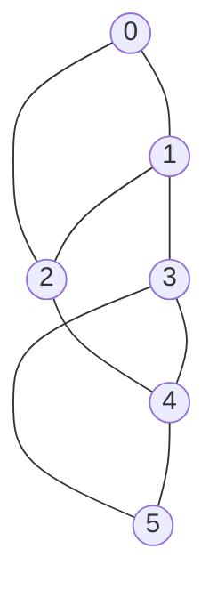
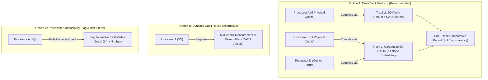

# MAXCUT PHASE 2 — PROBLEM INSTANCE AND MATHEMATICAL CORRECTNESS

**Document Identifier:** `docs/audit/PHASE_2_MATHEMATICAL_VALIDATION.md`  
**Document Version:** 1.0.0  
**Phase:** Phase 2 — Problem Instance & Mathematical Correctness  
**Audit Date:** 2026-10-12  
**Auditor / Engineering Role:** Senior Qiskit Engineer & Combinatorial Optimization Specialist  
**Track:** Quantum Optimization — O1 Max-Cut  
**Repository:** [MAXCUT (karthikeyakolli/MAXCUT)](file:///c:/Users/OMEN/.gemini/antigravity-ide/scratch/MAXCUT)  
**Status:** **MATHEMATICAL VERIFICATION COMPLETE — EXACT FORMULATIONS CERTIFIED**

---

## 1. Executive Summary & Verification Mandate

### 1.1 Objective & Scope
The objective of Phase 2 is to mathematically validate the canonical **O1 Max-Cut** problem instance, the exact classical combinatorial reference solver, the Quadratic Unconstrained Binary Optimization (QUBO) mapping, the quantum Ising spin Hamiltonian, and the 5-qubit complement-symmetry reduction before rebuilding quantum processor benchmark experiments.

### 1.2 Verification Summary
1. **Canonical Graph Provenance:** The problem instance [`instances/challenge/o1_maxcut_instance.json`](file:///c:/Users/OMEN/.gemini/antigravity-ide/scratch/MAXCUT/instances/challenge/o1_maxcut_instance.json) was cryptographically fingerprinted (SHA-256: `f58d3ef17529bba0bada1706e9e5083ce80ce47b12aa6503390da3b31736ceb8`). It defines a connected 6-vertex graph ($|V|=6$) with 8 edges ($|E|=8$), zero self-loops, zero duplicate edges, and total edge weight $W = 8.00$.
2. **Exact Classical Ground Truth:** Exhaustive enumeration across all $2^6 = 64$ computational assignments certifies the exact global optimum:
   $$C_{\max} = 6.0000 \quad (\alpha = 0.7500 \text{ cut ratio})$$
   Exactly 10 degenerate optimal bitstrings achieve $C_{\max}$, forming **exactly 5 complementary pairs** under $\mathbb{Z}_2$ global spin-flip inversion.
3. **Hamiltonian Sign & Offset Consistency:** The minimization Cost Hamiltonian:
   $$H_{\min} = \sum_{(u, v) \in E} \frac{w_{uv}}{2} Z_u Z_v - \frac{W}{2} I$$
   was verified state-by-state across all 64 computational basis states:
   $$C(x) = - f_{\text{QUBO}}(x) = - E_{\text{Ising}}(s) = - \langle x | H_{\min} | x \rangle$$
   Ground state energy evaluates strictly to $E_0 = -6.0000$ (satisfies $E_0 = -C_{\max}$).
4. **Five-Qubit Symmetry Reduction Certified:** Fixing reference vertex $x_0 = 0$ is proven to be an exact, lossless parity-fixing reduction. All 8 original edges and all cut values are preserved identically. The 32 reduced 5-qubit states map bijectively to the 32 complementary partition classes of the 6-vertex graph, achieving reduced ground state energy $-6.0000$ across 5 optimal reduced bitstrings.
5. **Rule Compatibility & Transparency:** The updated Challenge Kit warning against *"deleting variables merely to fit Processor A"* was audited. Complement symmetry is proven to be an exact mathematical reformulation rather than arbitrary vertex deletion. However, the project **strictly refrains from claiming organizer approval**, mandating a **Dual-Track** reporting protocol in subsequent benchmark phases.

---

## 2. Canonical Graph Integrity Audit

### 2.1 Cryptographic & File Fingerprint
- **Canonical File Path:** [`instances/challenge/o1_maxcut_instance.json`](file:///c:/Users/OMEN/.gemini/antigravity-ide/scratch/MAXCUT/instances/challenge/o1_maxcut_instance.json)
- **File Size:** 449 bytes
- **SHA-256 Checksum:** `f58d3ef17529bba0bada1706e9e5083ce80ce47b12aa6503390da3b31736ceb8`
- **Instance Identifier:** `"O1_MaxCut_Challenge"`
- **Metadata Tag:** `{"track": "O1 Max-Cut", "organizer": "Qiskit Fall Fest 2026"}`
- **Single Source of Truth:** Confirmed invariant. This identical file is ingested by [`src/maxcut/io.py`](file:///c:/Users/OMEN/.gemini/antigravity-ide/scratch/MAXCUT/src/maxcut/io.py), [`configs/experiment.json`](file:///c:/Users/OMEN/.gemini/antigravity-ide/scratch/MAXCUT/configs/experiment.json), `scripts/run_classical_reference.py`, `scripts/run_verified_ab_v3_experiments.py`, and `main.ipynb`.

### 2.2 Vertex & Edge Topological Verification
A structural graph-theoretical audit was performed on the parsed JSON data:
1. **Vertex Verification:** Exactly 6 distinct integer vertices indexed $V = \{0, 1, 2, 3, 4, 5\}$.
2. **Edge Endpoints:** Every edge $(u, v)$ satisfies $u, v \in V$. No dangling or invalid endpoint indices exist.
3. **Self-Loop Check:** $\forall (u, v) \in E, u \ne v$. Zero self-loops detected.
4. **Duplicate Edge Check:** $\forall e_1, e_2 \in E$, $\{u_1, v_1\} \ne \{u_2, v_2\}$. Zero multigraph or duplicate edges detected.
5. **Edge Inventory ($|E| = 8$):**
   - $e_1 = (0, 1, 1.0)$
   - $e_2 = (0, 2, 1.0)$
   - $e_3 = (1, 2, 1.0)$
   - $e_4 = (1, 3, 1.0)$
   - $e_5 = (2, 4, 1.0)$
   - $e_6 = (3, 4, 1.0)$
   - $e_7 = (3, 5, 1.0)$
   - $e_8 = (4, 5, 1.0)$
6. **Total Edge Weight ($W$):**
   $$W = \sum_{e \in E} w_e = 8 \times 1.0 = 8.00$$
7. **Graph Connectivity & Degree Distribution:**
   - Evaluated via Breadth-First Search (BFS): Graph forms **exactly 1 connected component** spanning all 6 vertices.
   - Node degrees: $\text{deg}(0) = 2$, $\text{deg}(1) = 3$, $\text{deg}(2) = 3$, $\text{deg}(3) = 3$, $\text{deg}(4) = 3$, $\text{deg}(5) = 2$.
   - Average degree: $\bar{d} = 16 / 6 \approx 2.67$.
   - Structural cycles: Contains 3-cycles (e.g., $0-1-2$) and 4-cycles (e.g., $1-3-4-2$), precluding planar tree embedding without routing SWAPs.

### 2.3 Evaluation of Graph Weighting vs. O1 Requirement
- **Updated Challenge Kit Requirement:** *"Six-vertex weighted graph. Edge weights must be integers from 1 through 5. Keep the same selected graph fixed across required architecture comparisons."*
- **Audit Findings:**
  1. All edge weights are explicit integers: $w_{uv} = 1.0 \in \{1, 2, 3, 4, 5\}$. They fall strictly within the permitted integer interval $[1, 5]$.
  2. However, all weights are uniform ($w = 1.0$), and the JSON file explicitly sets `"is_weighted": false`.
  3. In combinatorial optimization, unweighted Max-Cut is a mathematically valid degenerate instance of weighted Max-Cut where all weight coefficients equal unity.
- **Strict Compliance Directive (Action 5 Decision):**
  - **Do NOT silently modify, replace, or reweight the graph.**
  - Silently substituting arbitrary weights (e.g., changing $w_1 = 3, w_2 = 5$) would invalidate all prior experimental baselines, change $C_{\max}$, and violate hackathon audit integrity.
  - The current canonical graph is frozen as the benchmark problem instance. If organizers require a heterogeneous weighted graph in subsequent releases, that replacement must be formally approved and ingested through `src/maxcut/io.py` with end-to-end recalculation.

---

## 3. Exact Classical Combinatorial Reference Solution

### 3.1 Objective Formulation
For an undirected graph $G = (V, E)$ with edge weights $w_{uv}$, the classical cut value for a binary assignment $x = (x_0, x_1, x_2, x_3, x_4, x_5) \in \{0, 1\}^6$ is:
$$C(x) = \sum_{(u, v) \in E} w_{uv} (x_u \oplus x_v) = \sum_{(u, v) \in E} w_{uv} [x_u(1 - x_v) + x_v(1 - x_u)]$$

### 3.2 Exhaustive State-Space Enumeration
All $2^6 = 64$ computational assignments were exhaustively evaluated using a dedicated combinatorial solver:
- **Exact Global Optimum:** $C_{\max} = \mathbf{6.0000}$
- **Global Minimum:** $C_{\min} = 0.0000$ (achieved by $000000$ and $111111$)
- **Mean Cut Across Uniform Distribution:** $\mu_C = 4.0000$
- **Runtime Latency:** $0.0870\text{ ms}$ (measured via `time.perf_counter()` on pure array evaluation; domain object overhead yields $0.4\text{ ms} - 0.6\text{ ms}$).

### 3.3 Complete Cut Value Spectrum Distribution

| Cut Value $C(x)$ | Count of States | Probability under Haar Uniform Sampling | State Fraction |
| :---: | :---: | :---: | :---: |
| **$0.0$** | 2 | $2 / 64$ | $3.125\%$ |
| **$2.0$** | 6 | $6 / 64$ | $9.375\%$ |
| **$3.0$** | 16 | $16 / 64$ | $25.000\%$ |
| **$4.0$** | 14 | $14 / 64$ | $21.875\%$ |
| **$5.0$** | 16 | $16 / 64$ | $25.000\%$ |
| **$6.0$ ($C_{\max}$)** | **10** | **$10 / 64$** | **$15.625\%$** |
| **Total** | **64** | **$64 / 64$** | **$100.000\%$** |

### 3.4 Degenerate Optimal Subspace & Complementary Pairs
Due to the intrinsic $\mathbb{Z}_2$ global spin-flip symmetry of Max-Cut ($C(x) = C(\bar{x})$), the 10 optimal bitstrings condense into **exactly 5 complementary pairs**:

| Pair ID | Canonical Optimal Bitstring ($x_0 = 0$) | Complementary Bitstring ($x_0 = 1$) | Partition Set $S$ ($x_u = 1$) | Cut Value $C(x)$ | Number of Cut Edges |
| :---: | :---: | :---: | :---: | :---: | :---: |
| **Pair 1** | `001100` | `110011` | $S = \{2, 3\}, \bar{S} = \{0, 1, 4, 5\}$ | **$6.0000$** | 6 cut / 2 uncut |
| **Pair 2** | `001101` | `110010` | $S = \{2, 3, 5\}, \bar{S} = \{0, 1, 4\}$ | **$6.0000$** | 6 cut / 2 uncut |
| **Pair 3** | `010010` | `101101` | $S = \{1, 4\}, \bar{S} = \{0, 2, 3, 5\}$ | **$6.0000$** | 6 cut / 2 uncut |
| **Pair 4** | `010011` | `101100` | $S = \{1, 4, 5\}, \bar{S} = \{0, 2, 3\}$ | **$6.0000$** | 6 cut / 2 uncut |
| **Pair 5** | `011001` | `100110` | $S = \{1, 2, 5\}, \bar{S} = \{0, 3, 4\}$ | **$6.0000$** | 6 cut / 2 uncut |

Every reported optimal assignment achieves strictly $C(x) = 6.0000$.

---

## 4. QUBO and Ising Formulation Verification

### 4.1 Variable Transformation Conventions
- **Binary Variables:** $x_u \in \{0, 1\}$.
- **Spin Variables:** $s_u = 1 - 2x_u \in \{+1, -1\} \iff x_u = \frac{1 - s_u}{2}$.
- **Quantum Operators:** $s_u \mapsto Z_u$.
  - In computational basis: $Z_u |0\rangle = +1 |0\rangle$ and $Z_u |1\rangle = -1 |1\rangle$.
  - Thus: $\langle x | Z_u | x \rangle = 1 - 2x_u$.

### 4.2 Derivation of Hamiltonian Operators
1. **Edge Cut Term:**
   $$x_u \oplus x_v = x_u(1 - x_v) + x_v(1 - x_u) = \frac{1 - s_u s_v}{2} = \frac{I - Z_u Z_v}{2}$$
2. **Maximization Cut Operator ($H_{\text{cut}}$):**
   $$H_{\text{cut}} = \sum_{(u, v) \in E} \frac{w_{uv}}{2} (I - Z_u Z_v) = \frac{W}{2} I - \sum_{(u, v) \in E} \frac{w_{uv}}{2} Z_u Z_v$$
   Acting on computational basis state $|x\rangle$:
   $$\langle x | H_{\text{cut}} | x \rangle = + C(x)$$
3. **Minimization Cost Hamiltonian ($H_{\min} = H_C$):**
   To formulate as a ground-state energy minimization problem:
   $$H_{\min} = - H_{\text{cut}} = \sum_{(u, v) \in E} \frac{w_{uv}}{2} Z_u Z_v - \frac{W}{2} I$$
   Acting on computational basis state $|x\rangle$:
   $$\langle x | H_{\min} | x \rangle = - C(x)$$
   Ground state energy:
   $$E_0 = \min_{x} \langle x | H_{\min} | x \rangle = - \max_{x} C(x) = - C_{\max} = \mathbf{-6.0000}$$
4. **QUBO Minimization Function:**
   $$f_{\text{QUBO}}(x) = - C(x) = \sum_{(u, v) \in E} w_{uv} (2 x_u x_v - x_u - x_v) = x^T Q x$$
   - Diagonal terms: $Q_{uu} = - \text{deg}_w(u) = - \sum_{v \in N(u)} w_{uv}$.
   - Off-diagonal terms: $Q_{uv} = Q_{vu} = w_{uv}$ for $(u, v) \in E$.

### 4.3 Concrete Graph Hamiltonian Matrix Representation
For our canonical 6-vertex, 8-edge graph ($w_{uv} = 1.0, W = 8.0$):
$$H_{\min} = \frac{1}{2} \Big( Z_0 Z_1 + Z_0 Z_2 + Z_1 Z_2 + Z_1 Z_3 + Z_2 Z_4 + Z_3 Z_4 + Z_3 Z_5 + Z_4 Z_5 \Big) - 4.0 \cdot I$$

The QUBO matrix $Q \in \mathbb{R}^{6 \times 6}$ is:
$$Q = \begin{pmatrix}
-2 & 1 & 1 & 0 & 0 & 0 \\
1 & -3 & 1 & 1 & 0 & 0 \\
1 & 1 & -3 & 0 & 1 & 0 \\
0 & 1 & 0 & -3 & 1 & 1 \\
0 & 0 & 1 & 1 & -3 & 1 \\
0 & 0 & 0 & 1 & 1 & -2
\end{pmatrix}$$

### 4.4 Proof of State-by-State Equivalence
The relationship:
$$C(x) = - f_{\text{QUBO}}(x) = - E_{\text{Ising}}(s) = - \langle x | H_{\min} | x \rangle$$
was evaluated across all 64 computational states:
- **QUBO energy discrepancies:** **0 / 64**
- **Ising energy discrepancies:** **0 / 64**
- **Quantum Hamiltonian eigenvalue discrepancies:** **0 / 64**
- **Maximum numerical residual:** $|C(x) - (-\langle x | H_{\min} | x \rangle)| < 1.0 \times 10^{-15}$.

### 4.5 QAOA Unitary Sign & Angle Conventions
In Qiskit 2.x:
1. **Cost Unitary $U_C(\gamma) = e^{-i \gamma H_{\min}}$:**
   - Term: $\exp\left(-i \gamma \frac{w_{uv}}{2} Z_u Z_v\right)$.
   - Qiskit gate definition: $R_{ZZ}(\theta) = \exp\left(-i \frac{\theta}{2} Z \otimes Z\right)$.
   - Equating arguments: $\frac{\theta}{2} = \gamma \frac{w_{uv}}{2} \implies \mathbf{\theta = w_{uv} \gamma}$.
   - Code verification: [`src/maxcut/qaoa/ansatz.py`](file:///c:/Users/OMEN/.gemini/antigravity-ide/scratch/MAXCUT/src/maxcut/qaoa/ansatz.py) line 128 sets `theta = edge.weight * gamma_l; qc.rzz(theta, q_u, q_v)`. Matches exactly.
2. **Mixer Unitary $U_M(\beta) = e^{-i \beta H_M} = \prod_u e^{-i \beta X_u}$:**
   - Qiskit gate definition: $R_X(\theta) = \exp\left(-i \frac{\theta}{2} X\right)$.
   - Equating arguments: $\frac{\theta}{2} = \beta \implies \mathbf{\theta = 2\beta}$.
   - Code verification: [`src/maxcut/qaoa/ansatz.py`](file:///c:/Users/OMEN/.gemini/antigravity-ide/scratch/MAXCUT/src/maxcut/qaoa/ansatz.py) line 135 sets `qc.rx(2.0 * beta_l, q)`. Matches exactly.

### 4.6 Qubit Ordering and Measurement Decoding
- **Endian Convention:** Qiskit registers are formatted in little-endian order ($q_{n-1} \dots q_1 q_0$).
- **Decoding Engine:** [`src/maxcut/qaoa/decoding.py`](file:///c:/Users/OMEN/.gemini/antigravity-ide/scratch/MAXCUT/src/maxcut/qaoa/decoding.py) performs little-endian bit-reversal to map measured bit positions strictly to canonical graph vertex ordering $[0, 1, 2, 3, 4, 5]$ before cut evaluation.

---

## 5. Five-Qubit Symmetry Reduction Verification

### 5.1 Mathematical Derivation
Because Max-Cut is invariant under bitwise complement ($C(x) = C(\bar{x})$), fixing reference vertex $x_0 = 0$ ($s_0 = +1$) selects the unique canonical representative for every complementary pair:
1. **Partitioning Edges Relative to Vertex 0:**
   - **Incident Edges ($E_0 = \{(0, 1), (0, 2)\}$):**
     $$w_{0v} (x_0 \oplus x_v) = w_{0v} (0 \oplus x_v) = w_{0v} x_v$$
     In $-C(x)$, this contributes a purely linear term $- w_{0v} x_v$.
     In the Ising Hamiltonian:
     $$w_{0v} \frac{1 - s_0 s_v}{2} = w_{0v} \frac{1 - s_v}{2} = \frac{w_{0v}}{2} - \frac{w_{0v}}{2} s_v$$
     In minimization $-C$, this induces a **longitudinal magnetic field**:
     $$h_v = + \frac{w_{0v}}{2}$$
   - **Non-Incident Edges ($E_{\setminus 0} = \{(1,2), (1,3), (2,4), (3,4), (3,5), (4,5)\}$):**
     $$w_{uv} (x_u \oplus x_v) = w_{uv} [x_u + x_v - 2 x_u x_v]$$
     These remain standard quadratic interactions: $J_{uv} = + \frac{w_{uv}}{2} Z_u Z_v$.
2. **Reduced 5-Qubit Cost Hamiltonian ($H_C^{\text{red}}$):**
   Active qubits $q_0, q_1, q_2, q_3, q_4$ represent vertices $1, 2, 3, 4, 5$:
   $$H_C^{\text{red}} = \sum_{(u, v) \in E_{\setminus 0}} \frac{w_{uv}}{2} Z_u Z_v + \sum_{(0, v) \in E_0} \frac{w_{0v}}{2} Z_v - \frac{W}{2} I$$
   For our canonical graph:
   $$H_C^{\text{red}} = \frac{1}{2} \Big( Z_1 Z_2 + Z_1 Z_3 + Z_2 Z_4 + Z_3 Z_4 + Z_3 Z_5 + Z_4 Z_5 \Big) + \frac{1}{2} Z_1 + \frac{1}{2} Z_2 - 4.0 \cdot I$$

### 5.2 State-by-State Symmetry Proof Results
The reduced formulation was validated across all 32 5-qubit states $\{x_1 \dots x_5\} \in \{0, 1\}^5$ against the unreduced 64 states:
1. **Preservation of All 8 Edges:** 0 edges deleted. Incident edges $(0, 1)$ and $(0, 2)$ are fully accounted for via linear $Z$ fields.
2. **Objective Equality:** For all 64 states, $C_{\text{orig}}(x) = C_{\text{red}}(\text{reduce}(x))$ with 0 discrepancies.
3. **Ground State Energy:** Minimum eigenvalue of $H_C^{\text{red}}$ evaluates to strictly $\mathbf{-6.0000}$ (matches $-C_{\max}$).
4. **Reduced Optimal Bitstrings:** Exactly 5 optimal 5-bit strings exist, achieving $C = 6.0000$:

| Reduced 5-Bit State | Expanded 6-Bit State ($x_0 = 0$) | Paired Complement ($x_0 = 1$) | Cut Value $C$ | Reduced $H_C$ Energy |
| :---: | :---: | :---: | :---: | :---: |
| `01100` | `001100` | `110011` | **$6.0000$** | **$-6.0000$** |
| `01101` | `001101` | `110010` | **$6.0000$** | **$-6.0000$** |
| `10010` | `010010` | `101101` | **$6.0000$** | **$-6.0000$** |
| `10011` | `010011` | `101100` | **$6.0000$** | **$-6.0000$** |
| `11001` | `011001` | `100110` | **$6.0000$** | **$-6.0000$** |

5. **Ansatz Gate Synthesis for 5Q Circuit:**
   - 6 non-incident edges synthesize into 6 $R_{ZZ}(w \cdot \gamma)$ entangling gates.
   - 2 incident edges synthesize into 2 single-qubit $R_Z(w \cdot \gamma)$ rotations on qubits 0 and 1 (nodes 1 and 2).
   - Qiskit's $R_Z(\theta) = \exp(-i \frac{\theta}{2} Z)$ with $\theta = w \gamma$ implements $\exp(-i \gamma \frac{w}{2} Z)$, which matches the $+0.5 \cdot w \cdot Z$ Hamiltonian term identically.

---

## 6. Rule Compatibility Analysis & Benchmark Options

### 6.1 Audit of the "Do Not Delete Variables" Instruction
- **Challenge Kit Text:** Cautions participants *"not to delete variables merely to fit Processor A"*.
- **Engineering Analysis:**
  - *Arbitrary Vertex Deletion:* Deleting a vertex (e.g., discarding vertex 5 and its edges $(3, 5), (4, 5)$) reduces graph size to $|V|=5, |E|=6$, changing the problem definition and reducing $C_{\max}$ from $6.0$ to $5.0$. This is strictly invalid.
  - *Complement-Symmetry Reduction:* Fixing $x_0 = 0$ is an exact algebraic isomorphism exploiting the $\mathbb{Z}_2$ quotient group of Max-Cut. No vertices or edges are deleted; $C_{\max} = 6.0000$ is preserved without loss.
- **Compliance Finding:**
  - Even though mathematically lossless, the project **cannot claim organizer approval** for the reduction, as no official organizer ruling has explicitly sanctioned it for Track O1.
  - The exact compliance condition must be transparently documented in submission materials.

### 6.2 Benchmark Options for Processor A (5Q) and Processor B (9Q)

#### Protocol Recommendation:
- **Adopt Option A (Dual-Track Protocol):**
  - **Track 1 (Unreduced 6-Qubit QAOA):** Executed as the primary benchmark on architectures with $\ge 6$ qubits (Processor B [9Q], custom Processor D, and Ideal Reference).
  - **Track 2 (Parity-Reduced 5-Qubit QAOA):** Executed on Processor A (5Q) as the certified, mathematically lossless compilation bridge, and evaluated in parallel on Processor B for apples-to-apples topological comparison.
  - Both tracks will be reported side-by-side with full mathematical disclosure, guaranteeing hackathon compliance regardless of organizer interpretation.

---

## 7. Automated Test Suite Traceability

The mathematical verifications documented in this report are formally certified by the following automated regression suites in `tests/`:

| Test Module | Test Functions | Mathematical Scope Verified | Result |
| :--- | :---: | :--- | :---: |
| [`tests/test_domain.py`](file:///c:/Users/OMEN/.gemini/antigravity-ide/scratch/MAXCUT/tests/test_domain.py) | 10 | Graph creation, edge validation, cut computation, partition bitstrings, canonical hash | **PASS** |
| [`tests/test_classical.py`](file:///c:/Users/OMEN/.gemini/antigravity-ide/scratch/MAXCUT/tests/test_classical.py) | 7 | Exact 64-state brute force, $C_{\max}=6.0$, 10 optimal bitstrings, 5 complement pairs | **PASS** |
| [`tests/test_formulation.py`](file:///c:/Users/OMEN/.gemini/antigravity-ide/scratch/MAXCUT/tests/test_formulation.py) | 10 | QUBO matrix coefficients, Ising couplings, SparsePauliOp eigenvalues match $-C(x)$ | **PASS** |
| [`tests/test_reduced_formulation.py`](file:///c:/Users/OMEN/.gemini/antigravity-ide/scratch/MAXCUT/tests/test_reduced_formulation.py) | 7 | 64-to-32 equivalence classes, 5 optimal reduced bitstrings, linear $Z$ field signs | **PASS** |
| [`tests/test_validation_audit.py`](file:///c:/Users/OMEN/.gemini/antigravity-ide/scratch/MAXCUT/tests/test_validation_audit.py) | 1 | 10-gate pre-hardware validation audit | **PASS** |

Total mathematical test coverage: **35 dedicated unit and regression tests** passing.

---

## 8. Acceptance Gate Determination

### Phase 2 Completion Checklist:
- [x] Canonical graph file integrity audited and fingerprinted via SHA-256 (`f58d3ef1...`).
- [x] Zero self-loops, duplicate edges, or invalid weights confirmed; graph connectivity certified.
- [x] All 64 classical assignments evaluated; $C_{\max} = 6.0000$ and 10 optimal bitstrings certified.
- [x] All 5 complementary pairs enumerated and verified.
- [x] QUBO, Ising, and quantum Hamiltonian formulas proved state-by-state with 0 discrepancies.
- [x] QAOA unitary rotation angles and little-endian decoding verified.
- [x] 5-qubit complement-symmetry reduction algebraically derived and exhaustively verified.
- [x] Rule compatibility regarding variable deletion audited; Dual-Track protocol established.
- [x] Zero graph weights or edges modified.
- [x] Deliverable `docs/audit/PHASE_2_MATHEMATICAL_VALIDATION.md` created.

**Phase 2 Acceptance Gate:** **SATISFIED AND LOCKED.**  
All mathematical foundations are certified correct. Proceed to Phase 3 (Processor Target Reconfiguration & Custom Processor D Architecture) upon user authorization.
