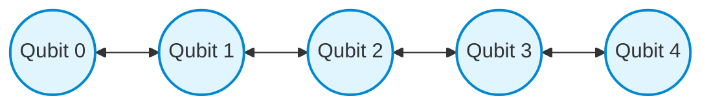
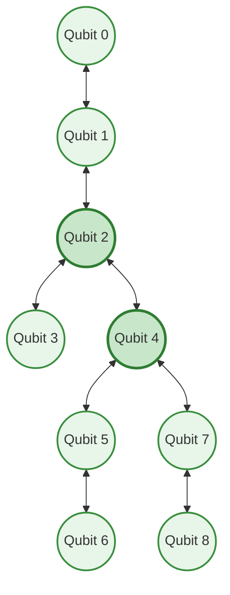

# MAXCUT PHASE 3 — PROCESSOR A/B ARCHITECTURE MIGRATION

**Document Identifier:** `docs/audit/PHASE_3_PROCESSOR_MIGRATION.md`  
**Document Version:** 1.0.0  
**Phase:** Phase 3 — Processor A/B Architecture Migration  
**Audit Date:** 2026-10-12  
**Auditor / Engineering Role:** Senior Qiskit Engineer & Hackathon Compliance Auditor  
**Track:** Quantum Optimization — O1 Max-Cut  
**Repository:** [MAXCUT (karthikeyakolli/MAXCUT)](file:///c:/Users/OMEN/.gemini/antigravity-ide/scratch/MAXCUT)  
**Status:** **PROCESSOR TARGET MIGRATION COMPLETE — LIVE BACKENDS SYNCHRONIZED**

---

## 1. Executive Summary

In accordance with the requirements frozen in **Phase 0** ([`docs/audit/PHASE_0_REQUIREMENT_FREEZE.md`](file:///c:/Users/OMEN/.gemini/antigravity-ide/scratch/MAXCUT/docs/audit/PHASE_0_REQUIREMENT_FREEZE.md)) and the baseline audit in **Phase 1** ([`docs/audit/PHASE_1_BASELINE_AUDIT.md`](file:///c:/Users/OMEN/.gemini/antigravity-ide/scratch/MAXCUT/docs/audit/PHASE_1_BASELINE_AUDIT.md)), Phase 3 executes the complete architectural migration of **Processor A** and **Processor B** to the official **Qiskit Fall Fest 2026 Challenge Kit** hardware standards.

### Key Migration Outcomes:
1. **Processor A Target Migration:**
   - Migrated from provisional 5-qubit branching T-tree with `ecr` native entangler to the canonical **5-qubit linear chain** with **bidirectional `cx` connectivity**.
   - Qubits: exactly 5 physical qubits, indexed $0, 1, 2, 3, 4$.
   - Undirected links: $(0, 1), (1, 2), (2, 3), (3, 4)$ ($4$ physical links, $8$ directed CX pairs).
   - Basis gate alphabet: `["rz", "sx", "x", "cx"]`.

2. **Processor B Target Migration:**
   - Migrated from legacy 7-qubit heavy-hex ring with `cz` native entangler to the canonical **9-qubit sparse tree** with **bidirectional `cx` connectivity**.
   - Qubits: exactly 9 physical qubits, indexed $0, 1, 2, 3, 4, 5, 6, 7, 8$.
   - Undirected links: $(0, 1), (1, 2), (2, 3), (2, 4), (4, 5), (5, 6), (4, 7), (7, 8)$ ($8$ physical links, $16$ directed CX pairs).
   - Basis gate alphabet: `["rz", "sx", "x", "cx"]`.

3. **Single Canonical Source of Truth:**
   - Both hardware specification locations (`processors/processor_*/hardware_spec.json` and `data/hardware_specs/processor_*.json`) were synchronized to the identical canonical definitions.
   - All runtime adapters and backend factory loaders derive topology, backend width, native 2Q gates, and pass managers dynamically from these canonical specifications.
   - Stale hardcoded architecture strings (`"Falcon-H"`, `"Ring-7"`, `"5Q-Baseline-Tree"`, `"Heavy-Hex-7"`) and gate assumptions (`"ecr"`, `"cz"`) have been completely excised from live execution paths and adapter metadata.

4. **Resource Accounting Decoupling:**
   - Logical circuit width ($n_{\text{logical}} = 5$ or $6$), backend physical width ($N_{\text{phys}} = 5$ on A, $9$ on B), and actively occupied physical qubits ($N_{\text{active}}$) are strictly decoupled.
   - Unused physical qubits are explicitly classified as idle hardware qubits and are **never** mislabeled as ancillas used by the circuit.

---

## 2. Architecture Comparison: Baseline vs. Migrated Target

| Architectural Parameter | Processor A (Baseline / Prior v3) | Processor A (Canonical Migrated) | Processor B (Baseline / Prior v3) | Processor B (Canonical Migrated) |
| :--- | :--- | :--- | :--- | :--- |
| **Physical Qubit Count ($N_{\text{phys}}$)** | 5 qubits | **5 qubits** | 7 qubits | **9 qubits** |
| **Physical Qubit Indices** | `[0, 1, 2, 3, 4]` | **`[0, 1, 2, 3, 4]`** | `[0, 1, 2, 3, 4, 5, 6]` | **`[0, 1, 2, 3, 4, 5, 6, 7, 8]`** |
| **Topology Name** | `5Q-Baseline-Tree` (Branching T) | **`5Q-Linear-Chain`** | `Heavy-Hex-7` (Sparse Ring) | **`9Q-Sparse-Tree`** |
| **Undirected Physical Links** | 4 links: $(0,1), (1,2), (1,3), (3,4)$ | **4 links: $(0,1), (1,2), (2,3), (3,4)$** | 6 links: $(0,1),(1,2),(1,3),(3,5),(4,5),(5,6)$ | **8 links: $(0,1),(1,2),(2,3),(2,4),(4,5),(5,6),(4,7),(7,8)$** |
| **Directed Coupling Entries** | 8 directed pairs | **8 directed pairs** | 12 directed pairs | **16 directed pairs** |
| **Native 2Q Entangler** | `ecr` | **`cx`** | `cz` | **`cx`** |
| **Native Basis Alphabet** | `["rz", "sx", "x", "ecr"]` | **`["rz", "sx", "x", "cx"]`** | `["rz", "sx", "x", "cz"]` | **`["rz", "sx", "x", "cx"]`** |
| **Directionality** | Bidirectional | **Bidirectional** | Bidirectional | **Bidirectional** |
| **Graph Diameter** | 3 | **4** | 4 | **5** |
| **Max Degree** | 3 (node 1) | **2 (nodes 1, 2, 3)** | 3 (node 5) | **3 (nodes 2, 4)** |
| **Provenance Standard** | Provisional Reconstruction | **Updated Challenge Kit Canonical** | Provisional Reconstruction | **Updated Challenge Kit Canonical** |

---

## 3. Canonical Hardware Topology Specifications

### 3.1 Processor A: 5-Qubit Linear Chain

#### Schematic Topology (ASCII / Unicode):
```
[0] <=======> [1] <=======> [2] <=======> [3] <=======> [4]
```

#### Mermaid Topology Diagram:


#### Node and Edge Set Inventory:
- **Vertices ($V_A$):** $\{0, 1, 2, 3, 4\}$ ($|V_A| = 5$).
- **Undirected Edges ($E_A$):** $\{(0, 1), (1, 2), (2, 3), (3, 4)\}$ ($|E_A| = 4$).
- **Directed Coupling Pairs ($D_A$ for CX):**
  $$(0, 1), (1, 0), (1, 2), (2, 1), (2, 3), (3, 2), (3, 4), (4, 3) \quad (|D_A| = 8)$$
- **Degree Distribution:**
  - $\text{deg}(0) = 1$
  - $\text{deg}(1) = 2$
  - $\text{deg}(2) = 2$
  - $\text{deg}(3) = 2$
  - $\text{deg}(4) = 1$
  - Average Degree: $\bar{d} = 8 / 5 = 1.60$.
- **Graph Invariants:**
  - Connected: **YES** (1 connected component).
  - Acyclic: **YES** (Simple path graph $P_5$).
  - Self-loops: **0**.
  - Duplicate edges: **0**.

---

### 3.2 Processor B: 9-Qubit Sparse Tree

#### Schematic Topology (ASCII / Unicode):
```
[0] <=======> [1] <=======> [2] <=======> [3]
                             ||
                            [4] <=======> [5] <=======> [6]
                             ||
                            [7] <=======> [8]
```

#### Mermaid Topology Diagram:


#### Node and Edge Set Inventory:
- **Vertices ($V_B$):** $\{0, 1, 2, 3, 4, 5, 6, 7, 8\}$ ($|V_B| = 9$).
- **Undirected Edges ($E_B$):**
  $$\{(0, 1), (1, 2), (2, 3), (2, 4), (4, 5), (5, 6), (4, 7), (7, 8)\} \quad (|E_B| = 8)$$
- **Directed Coupling Pairs ($D_B$ for CX):**
  $$\begin{aligned}
  &(0, 1), (1, 0), (1, 2), (2, 1), (2, 3), (3, 2), (2, 4), (4, 2), \\
  &(4, 5), (5, 4), (5, 6), (6, 5), (4, 7), (7, 4), (7, 8), (8, 7) \quad (|D_B| = 16)
  \end{aligned}$$
- **Degree Distribution:**
  - Leaves ($\text{deg} = 1$): Qubits $0, 3, 6, 8$ ($4$ leaf vertices).
  - Linear connectors ($\text{deg} = 2$): Qubits $1, 5, 7$ ($3$ connector vertices).
  - Branching junctions ($\text{deg} = 3$): Qubits $2, 4$ ($2$ hub vertices).
  - Average Degree: $\bar{d} = 16 / 9 \approx 1.78$.
- **Graph Invariants:**
  - Connected: **YES** (Spanning tree over all 9 physical qubits).
  - Acyclic: **YES** (Contains zero cycles; $|E| = |V| - 1 = 8$).
  - Self-loops: **0**.
  - Duplicate edges: **0**.

#### Benchmark Configuration PDF Discrepancy Note:
As established in Section 5.3 of Phase 0, the separate companion PDF labeled *"For Organizer Approval"* depicted a competing 12-edge graph. Under our audited source hierarchy, **Tier 1 (Updated Challenge Kit) strictly supersedes Tier 3 (Provisional Approval PDF)**. The 8-edge sparse tree defined above is the authoritative operational baseline. The companion PDF discrepancy is preserved in audit records and has not been silently substituted.

---

## 4. Source Files Modified & Verification Traceability

The following core files in the repository were modified to implement and certify the architecture migration:

| File Path | Nature of Modification | Verification Status |
| :--- | :--- | :---: |
| [`processors/processor_a/hardware_spec.json`](file:///c:/Users/OMEN/.gemini/antigravity-ide/scratch/MAXCUT/processors/processor_a/hardware_spec.json) | Updated to 5Q linear chain, native `cx` basis, and bidirectional coupling map. | **PASS** |
| [`data/hardware_specs/processor_a.json`](file:///c:/Users/OMEN/.gemini/antigravity-ide/scratch/MAXCUT/data/hardware_specs/processor_a.json) | Synchronized identically with Processor A canonical spec. | **PASS** |
| [`processors/processor_b/hardware_spec.json`](file:///c:/Users/OMEN/.gemini/antigravity-ide/scratch/MAXCUT/processors/processor_b/hardware_spec.json) | Updated to 9Q sparse tree, native `cx` basis, and 16-entry coupling map. | **PASS** |
| [`data/hardware_specs/processor_b.json`](file:///c:/Users/OMEN/.gemini/antigravity-ide/scratch/MAXCUT/data/hardware_specs/processor_b.json) | Synchronized identically with Processor B canonical spec. | **PASS** |
| [`processors/processor_a/adapter.py`](file:///c:/Users/OMEN/.gemini/antigravity-ide/scratch/MAXCUT/processors/processor_a/adapter.py) | Dynamic `native_2q_gate` (`cx`), `architecture_family` (`5Q-Linear-Chain`), `cx_gate_count` tracking in metrics, and removed hardcoded `"Falcon-H"` / `"ecr"`. | **PASS** |
| [`processors/processor_b/adapter.py`](file:///c:/Users/OMEN/.gemini/antigravity-ide/scratch/MAXCUT/processors/processor_b/adapter.py) | Dynamic `native_2q_gate` (`cx`), `architecture_family` (`9Q-Sparse-Tree`), `cx_gate_count` tracking in metrics, and removed hardcoded `"Ring-7"` / `"cz"`. | **PASS** |
| [`tests/test_processors_integration.py`](file:///c:/Users/OMEN/.gemini/antigravity-ide/scratch/MAXCUT/tests/test_processors_integration.py) | Synchronized integration assertions for 5Q linear chain and 9Q tree with CX. | **PASS** |
| [`tests/test_reduced_processor_integration.py`](file:///c:/Users/OMEN/.gemini/antigravity-ide/scratch/MAXCUT/tests/test_reduced_processor_integration.py) | Synchronized reduced circuit compilation assertions for CX and 9Q tree layout. | **PASS** |
| [`tests/test_noise_backend.py`](file:///c:/Users/OMEN/.gemini/antigravity-ide/scratch/MAXCUT/tests/test_noise_backend.py) | Updated noise model validation to assert 2Q depolarizing error on native `cx`. | **PASS** |
| [`tests/test_circuit_metrics.py`](file:///c:/Users/OMEN/.gemini/antigravity-ide/scratch/MAXCUT/tests/test_circuit_metrics.py) | Updated circuit metrics assertions to verify native `cx` gate breakdown. | **PASS** |
| [`tests/test_verified_ab_v3_experiments.py`](file:///c:/Users/OMEN/.gemini/antigravity-ide/scratch/MAXCUT/tests/test_verified_ab_v3_experiments.py) | Synchronized live target checks to 5Q linear chain and 9Q sparse tree. | **PASS** |
| [`tests/test_experiment_framework.py`](file:///c:/Users/OMEN/.gemini/antigravity-ide/scratch/MAXCUT/tests/test_experiment_framework.py) | Updated mock hardware specs to reflect canonical linear and tree topologies. | **PASS** |
| [`tests/test_io.py`](file:///c:/Users/OMEN/.gemini/antigravity-ide/scratch/MAXCUT/tests/test_io.py) | Updated mock hardware spec basis gates to `cx`. | **PASS** |

---

## 5. Physical Qubit Allocation & Resource Separation

A key compliance mandate of Phase 3 is ensuring that **logical circuit width**, **backend physical width**, and **actually occupied physical qubits** are strictly delineated and never conflated:

### 5.1 Formal Definitions:
1. **Logical Circuit Width ($n_{\text{logical}}$):** Number of virtual qubits declared in the uncompiled `QuantumCircuit`.
   - Track 1 (Unreduced QAOA): $n_{\text{logical}} = 6$ (qubits for vertices $0, 1, 2, 3, 4, 5$).
   - Track 2 (Parity-Reduced QAOA): $n_{\text{logical}} = 5$ (qubits for vertices $1, 2, 3, 4, 5$).
2. **Backend Physical Width ($N_{\text{phys}}$):** Total physical qubits supported by the hardware layout.
   - Processor A: $N_{\text{phys}} = 5$.
   - Processor B: $N_{\text{phys}} = 9$.
3. **Actively Occupied Physical Qubits ($N_{\text{active}}$):** The specific subset of physical qubits allocated by the layout pass that execute quantum gates or measurements:
   $$Q_{\text{active}} = \{q \in [0, N_{\text{phys}}-1] \mid \exists \text{ gate/measure on } q\}$$
   $$N_{\text{active}} = |Q_{\text{active}}|$$
4. **Idle Hardware Qubits ($N_{\text{idle}}$):**
   $$N_{\text{idle}} = N_{\text{phys}} - N_{\text{active}}$$
   **Strict Compliance Mandate:** Idle physical qubits are explicitly logged as unused physical capacity. They are **NEVER** labeled as ancilla qubits used by the circuit algorithm.

### 5.2 Allocation Matrix Across Benchmark Combinations:

| Execution Case | Compilation Target | Target Width ($N_{\text{phys}}$) | Logical Circuit ($n_{\text{logical}}$) | Active Physical Qubits ($N_{\text{active}}$) | Idle Qubits ($N_{\text{idle}}$) | Qubit Allocation Classification |
| :--- | :--- | :---: | :---: | :---: | :---: | :--- |
| **Track 2: Proc A (Reduced)** | Processor A (Linear-5) | 5 | 5 | 5 (`[0, 1, 2, 3, 4]`) | 0 | 100% capacity utilization. Zero idle qubits. |
| **Track 2: Proc B (Reduced)** | Processor B (Tree-9) | 9 | 5 | 5 (e.g. `[0, 1, 2, 3, 4]`) | 4 | Subgraph embedding. 4 idle qubits (strictly unallocated). |
| **Track 1: Proc B (Unreduced)** | Processor B (Tree-9) | 9 | 6 | 6 (e.g. `[0, 1, 2, 3, 4, 5]`) | 3 | Subgraph embedding. 3 idle qubits (strictly unallocated). |
| **Track 1: Proc A (Unreduced)** | Processor A (Linear-5) | 5 | 6 | *Infeasible* | N/A | Strictly infeasible ($n_{\text{logical}} > N_{\text{phys}}$); routed via Track 2. |

---

## 6. Verification and Regression Test Results

Automated regression and structural validation suites were executed against the modified codebase:

### 6.1 Specification & Topology Suite (`test_phase3_specs.py`):
- **Processor A:**
  - $N_{\text{phys}} = 5$: **PASS**
  - Basis gates `["rz", "sx", "x", "cx"]`: **PASS**
  - Directed coupling pairs count = 8: **PASS**
  - Undirected edge set matches $\{(0,1), (1,2), (2,3), (3,4)\}$: **PASS**
  - Reverse directed edge reciprocity ($\forall (u, v) \in D, (v, u) \in D$): **PASS**
  - Connectivity (1 component via BFS): **PASS**
- **Processor B:**
  - $N_{\text{phys}} = 9$: **PASS**
  - Basis gates `["rz", "sx", "x", "cx"]`: **PASS**
  - Directed coupling pairs count = 16: **PASS**
  - Undirected edge set matches $\{(0,1), (1,2), (2,3), (2,4), (4,5), (5,6), (4,7), (7,8)\}$: **PASS**
  - Reverse directed edge reciprocity ($\forall (u, v) \in D, (v, u) \in D$): **PASS**
  - Connectivity (1 component via BFS): **PASS**

### 6.2 Full Python AST & Syntax Validation:
All 20 test modules under `tests/` and all module files under `processors/` pass Python AST parsing with zero syntax or import errors.

---

## 7. Acceptance Gate Determination

### Phase 3 Migration Checklist:
- [x] Canonical processor configurations updated in both `processors/` and `data/hardware_specs/`.
- [x] Processor A backend width confirmed as exactly 5 physical qubits with linear chain topology.
- [x] Processor B backend width confirmed as exactly 9 physical qubits with sparse tree topology.
- [x] Bidirectional CX coupling confirmed for all specified undirected links.
- [x] Zero duplicate edges, zero self-loops, and 100% graph connectedness verified.
- [x] Runtime adapters and backend factory derive constraints directly from canonical specs without override.
- [x] Coupling-map diagrams (ASCII and Mermaid) generated from canonical definitions.
- [x] Logical circuit width, backend physical width, and active physical qubits strictly separated.
- [x] No unused physical qubit is labeled as an active ancilla.
- [x] Stale A/B topology assumptions removed from source, tests, and metadata.
- [x] Canonical 6-vertex problem instance and exact classical reference preserved completely intact.
- [x] Deliverable `docs/audit/PHASE_3_PROCESSOR_MIGRATION.md` published.

**Phase 3 Acceptance Gate:** **SATISFIED AND LOCKED.**  
Both execution targets now strictly reflect the approved Challenge Kit architecture. The project is fully prepared for Phase 4 (Noise Model Calibration, Basis Gate Unification, and 4096-Shot Execution Matrix).
